<div align="center">


# SuaLojaAqui

**Frente de caixa (PDV não fiscal) e gestão de estoque — white-label**

Caixa 100% pelo teclado · Vende sem internet · Comprovante térmico, A4 e PDF · Estoque com alertas de reposição


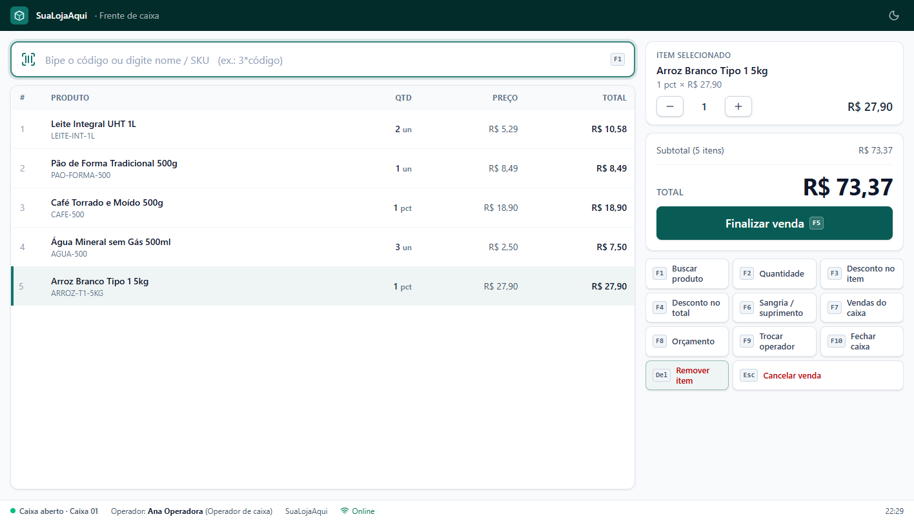

</div>

---

## 📑 Sumário

1. [Visão geral](#-visão-geral)
2. [Funcionalidades](#-funcionalidades)
3. [Telas](#-telas)
4. [Frente de caixa: atalhos de teclado](#️-frente-de-caixa-atalhos-de-teclado)
5. [White-label: como personalizar para um cliente](#-white-label-como-personalizar-para-um-cliente)
6. [Impressão](#️-impressão)
7. [Casos de uso](#-casos-de-uso)
8. [Arquitetura](#️-arquitetura)
9. [Modelo de dados](#️-modelo-de-dados)
10. [Diagrama de classes](#-diagrama-de-classes)
11. [Fluxos principais (sequência)](#-fluxos-principais)
12. [Estados](#-diagramas-de-estado)
13. [Regras de negócio e fórmulas](#-regras-de-negócio)
14. [Perfis e permissões](#-perfis-e-permissões)
15. [Segurança](#-segurança)
16. [API](#-api)
17. [Como rodar](#-como-rodar)
18. [Testes](#-testes)
19. [Estrutura de pastas](#️-estrutura-de-pastas)
20. [Próximas etapas](#-próximas-etapas)

---

## 🎯 Visão geral

O SuaLojaAqui une uma **frente de caixa não fiscal** a um **controle de estoque com reposição automática**. O caixa vende pelo leitor de código de barras, aceita várias formas de pagamento na mesma venda, calcula o troco e imprime o comprovante. Cada venda dá baixa no estoque, e o sistema avisa a gestão quando é hora de comprar.

É **white-label**: nome, logotipo, cores, tema e textos dos comprovantes mudam nas configurações, sem programar. "SuaLojaAqui" é apenas o nome padrão.

> **Não fiscal:** esta versão não emite NFC-e, SAT nem NF-e e não fala com a SEFAZ. Todo comprovante diz **"Documento Não Fiscal — Sem Valor Fiscal"**.

📄 O documento de requisitos, com a rastreabilidade de cada requisito até o código, está em **[docs/DRS-PDV.md](docs/DRS-PDV.md)**.
O que vem a seguir (clientes, troca/devolução, fiado, compras com nota, financeiro, fiscal e mais) está priorizado no **[DRS v2](docs/DRS-v2.md)**.

| Requisito do DRS | Como foi atendido |
|---|---|
| RF01 Abertura e fechamento de caixa | Troco inicial, totais por forma de pagamento, dinheiro esperado × contado e falta/sobra |
| RF02 Operação de venda | Bipagem, SKU ou nome, multiplicador `3*código` e descontos em R$ ou % por item e no total |
| RF03 Pagamento | Dinheiro + PIX + cartões na mesma venda, com troco automático (só do dinheiro) |
| RF04 Sangria e suprimento | Com justificativa obrigatória e comprovante |
| RF05–RF07 Estoque | Preços de custo e venda, baixa automática, estorno no cancelamento e ajuste só do administrador |
| RF08–RF09 Impressão | Térmica de 80/58 mm (navegador ou ESC/POS pela rede), A4, PDF e reimpressão em 2ª via |
| RF10–RF11 Acesso | Administrador, Gerente e Operador, PIN rápido para troca de operador e auditoria das ações sensíveis |
| RNF01 Menos de 100 ms por item | O item entra no cupom na hora. A busca por código é exata e indexada |
| RNF02 Não fiscal | Sem integração fiscal e com a menção obrigatória em todos os comprovantes |
| RNF03 Impressoras | Epson, Elgin, Bematech, Daruma e outras (driver do Windows ou ESC/POS pela rede) |
| Offline-first | O caixa vende sem internet e sincroniza sozinho, sem duplicar |

---

## ✨ Funcionalidades

| Módulo | O que faz |
|---|---|
| 🖥️ **Frente de caixa** | Tela cheia operada pelo teclado e pronta para touchscreen: busca, cupom, descontos, pagamento múltiplo, troco e orçamento |
| 👤 **Clientes** | Cadastro com CPF/CNPJ validado, histórico de compras e LGPD (consentimento, exportação e exclusão dos dados). No caixa: tecla **Ins** para identificar o cliente ou só o CPF na nota |
| 💳 **Formas de pagamento** | Configuráveis: dinheiro, PIX, cartões, vale-alimentação/refeição, cheque e outras, com regras de troco, exigência de cliente, taxa e prazo |
| 💵 **Caixa** | Abertura com troco inicial, sangria, suprimento, leitura parcial e fechamento com conferência |
| 🛡️ **Autorização do supervisor** | Desconto acima do limite, cancelamento de venda e sangria pedem usuário + PIN de um gerente |
| 📴 **Venda offline** | Sem internet o caixa continua vendendo, e as vendas sobem sozinhas quando a conexão volta |
| 🧾 **Comprovantes** | Venda, orçamento, sangria e fechamento: bobina de 80/58 mm, A4 ou PDF, com reimpressão em 2ª via |
| 📈 **Vendas** | Relatório por período: total, ticket médio, descontos, margem bruta, formas de pagamento, operadores e produtos mais vendidos. Exporta CSV |
| 🎨 **White-label** | Nome, logotipo, cor, tema claro/escuro e textos dos comprovantes, tudo nas configurações |
| 📦 **Produtos** | Cadastro com preço de custo e de venda, busca, filtros por situação e categoria e histórico |
| ⬇️⬆️ **Entradas e saídas** | Pedido recebido, retorno, perdas e ajustes (ajuste só do administrador) |
| 🔔 **Reposição (opcional por produto)** | EM, ES e PP calculados, com solicitação de pedido automática. Com o interruptor "Controlar consumo e reposição" desligado, o produto não pede consumo nem prazo e não gera solicitação |
| 📋 **Pedidos e relatórios de estoque** | Fluxo Pendente → Pedido feito → Recebido, estoque parado e rupturas |
| 👥 **Usuários** | Administrador, Gerente, Estoquista e Operador de caixa, com senha, PIN e bloqueio |
| 🛡️ **Auditoria** | Quem fez o quê e quando, inclusive itens removidos do cupom e abertura de gaveta |
| 🗂️ **Categorias** | Categorias e subcategorias (vêm prontas para mercadinho e padaria) |
| 🗑️ **Lixeira** | Recupera produtos excluídos dentro do prazo, depois apaga automaticamente |
| 🔑 **Esqueci minha senha** | Código de 6 números por e-mail (Gmail com senha de app ou outro SMTP), válido por 15 min |
| ⚖️ **LGPD** | Termo de Uso e Política de Privacidade com aceite versionado, “Baixar meus dados”, anonimização e retenção automática |
| ⚙️ **Configurações** | Regras ajustáveis sem programação |
| 📴 **Estoque offline** | Entradas e saídas registradas sem internet sincronizam quando a conexão volta |
| 🔌 **Integração PDV** | O caixa consulta o estoque e envia as vendas automaticamente |

---

## 🖼️ Telas

| Frente de caixa | Pagamento (dinheiro + PIX, com troco) |
|:-:|:-:|
|  | 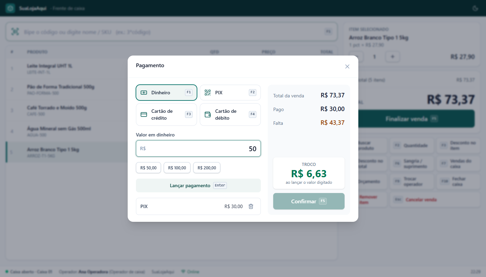 |
| **Venda concluída** | **Fechamento de caixa** |
| 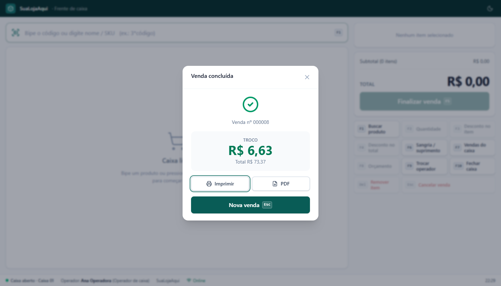 | 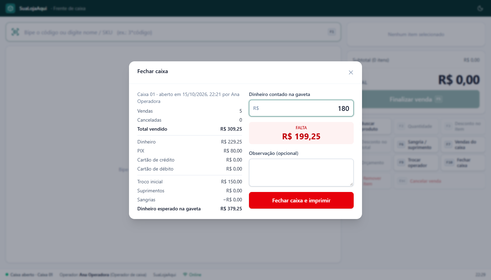 |
| **Tema escuro** | **Comprovante de 80 mm** |
| 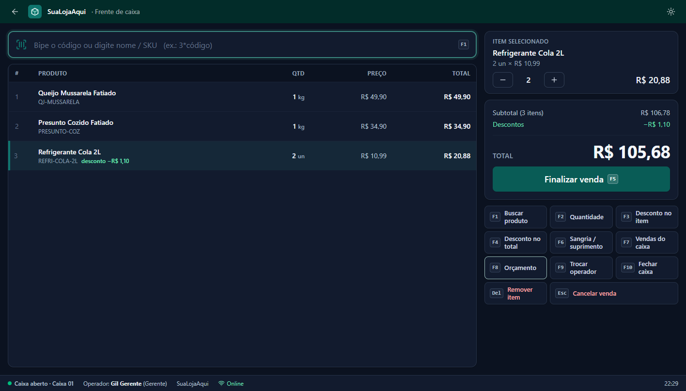 | 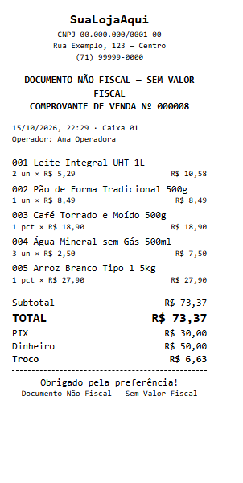 |
| **Relatório de vendas** | **Caixas (conferência por turno)** |
| 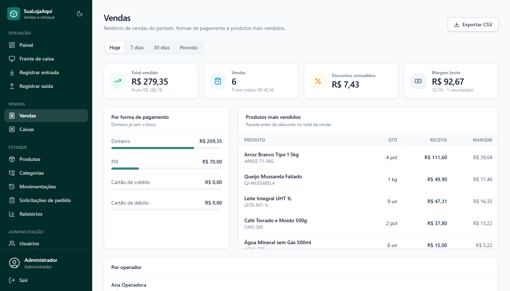 | 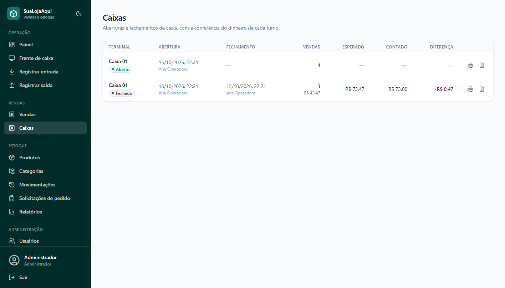 |
| **Painel** | **Configurações (white-label, impressão e caixa)** |
|  |  |
| **Login (senha ou PIN rápido)** | **Produtos** |
|  |  |
| **Cadastro com preços e indicadores** | **Detalhe do produto** |
|  |  |
| **Registrar saída (bipagem)** | **Modo offline** |
|  |  |
| **Relatórios de estoque** | **Solicitações de pedido** |
|  |  |
| **Celular** | |
|  &nbsp;  | |

---

## ⌨️ Frente de caixa: atalhos de teclado

O caixa (`/caixa`) funciona **inteiro pelo teclado**. O leitor de código de barras "digita" o código e envia Enter. Os mesmos comandos aparecem como botões para telas touch.

| Tecla | Ação |
|:-:|---|
| **F1** | Buscar produto (código de barras, SKU ou parte do nome). Use `3*código` para lançar 3 unidades |
| **F2** | Alterar a quantidade do item selecionado (aceita peso: `0,455`) |
| **F3** | Desconto no item (R$ ou %) |
| **F4** | Desconto no total da venda |
| **F5** | Finalizar venda (abre o pagamento). No pagamento, **confirma** |
| **F6** | Sangria / suprimento |
| **F7** | Vendas do caixa (reimprimir 2ª via ou cancelar) |
| **F8** | Orçamento em A4 ou PDF (não é venda e não baixa estoque) |
| **F9** | Trocar operador (usuário + PIN) |
| **F10** | Fechar caixa |
| **Ins** | Cliente da venda ou CPF/CNPJ na nota (busca, cadastro rápido) |
| **Del** | Remover o item selecionado |
| **Esc** | Cancelar a venda inteira (ou fechar a janela aberta) |
| **↑ ↓** | Selecionar item do cupom · **+ / −** alteram a quantidade |
| *No pagamento* | **F1–F4** e **F6–F9**: as formas de pagamento, na ordem de Configurações · **Enter** lança o valor · **F5** confirma |

> As teclas F nunca acionam o navegador dentro do caixa (o F5 não recarrega a página). A venda em andamento fica salva no computador: se a página fechar ou o PC travar, o cupom continua lá.

---

## 🎨 White-label: como personalizar para um cliente

Tudo fica em **Configurações → Identidade da loja**:

| Item | Onde aparece |
|---|---|
| Nome e slogan | Menu, login, título da aba, rodapé do caixa e comprovantes |
| Logotipo (PNG, JPEG, WebP ou SVG até 150 KB) | Menu, login, ícone da aba e cabeçalho do comprovante |
| Cor principal | O sistema inteiro: os tons claros e escuros são derivados dessa cor |
| Tema padrão (claro, escuro ou do sistema) | Cada computador ainda pode alternar pelo botão ☀️/🌙 |
| CNPJ/CPF, endereço, telefone e cabeçalho extra | Cabeçalho dos comprovantes |
| Mensagem de rodapé | Rodapé dos comprovantes ("Obrigado pela preferência!") |

A marca é pública (`GET /api/settings/branding`), então a tela de login já aparece com a cara do cliente. Ela também fica salva no aparelho e abre certa mesmo sem internet.

Para trocar o **padrão de fábrica** de uma nova instalação, edite `DEFAULT_SETTINGS.store` em [`settings.types.ts`](apps/api/src/modules/settings/settings.types.ts) e `DEFAULT_BRANDING` em [`brand.ts`](apps/web/src/lib/brand.ts).

---

## 🖨️ Impressão

| Conexão (Configurações → Impressão) | Para quê | Como funciona |
|---|---|---|
| **Impressora do Windows** (padrão) | Térmicas **USB ou serial** (Epson, Elgin, Bematech, Daruma...), impressoras A4 e "Salvar como PDF" | Impressão pelo navegador com o driver do fabricante, no papel configurado (80 mm, 58 mm ou A4) |
| **Térmica de rede (ESC/POS)** | Térmicas com placa de rede | A API envia ESC/POS direto para `IP:9100`, sem janela de impressão. Acentos em PC860, corte de papel e **abertura de gaveta** nas vendas em dinheiro |

- **Imprimir sem a janela de confirmação** (térmica USB): abra o navegador com `--kiosk-printing`. Exemplo de atalho: `msedge.exe --kiosk-printing --app=http://localhost:3000/caixa`.
- **Gaveta de dinheiro na USB**: ative a abertura da gaveta no driver da impressora.
- **PDF**: comprovante, orçamento e fechamento têm o botão **PDF**, que gera o arquivo (A4 ou no formato da bobina) até offline.
- Se a impressora de rede não responder, o sistema avisa e imprime pelo navegador.
- **Configurações → Impressão → Imprimir página de teste** confere a acentuação e o layout.

---

## 🧑‍🤝‍🧑 Casos de uso

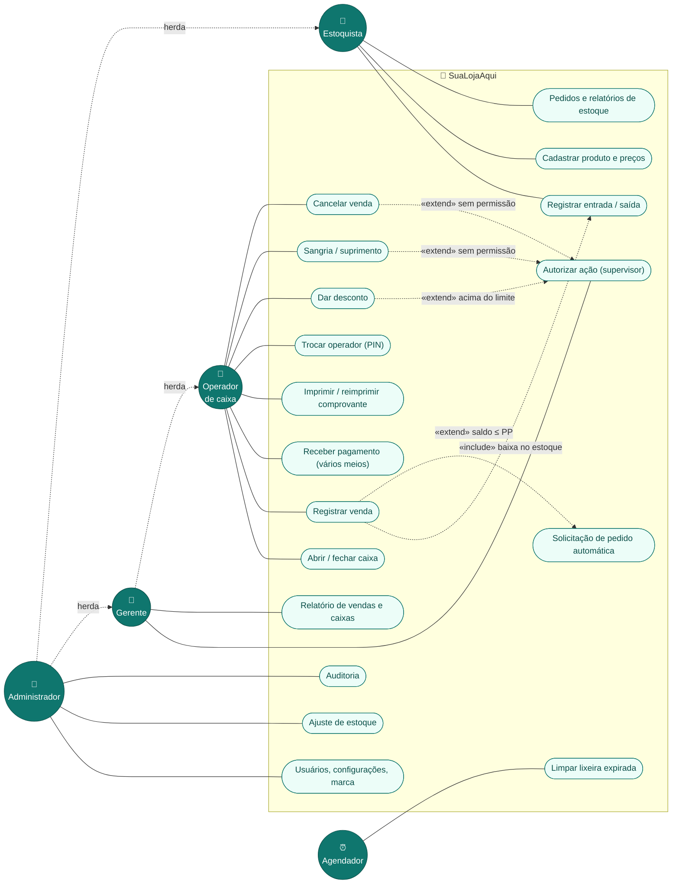

---

## 🏗️ Arquitetura

**Monólito modular** com domínio isolado. É simples de operar num PC da loja, e cada módulo evolui sem afetar os outros.

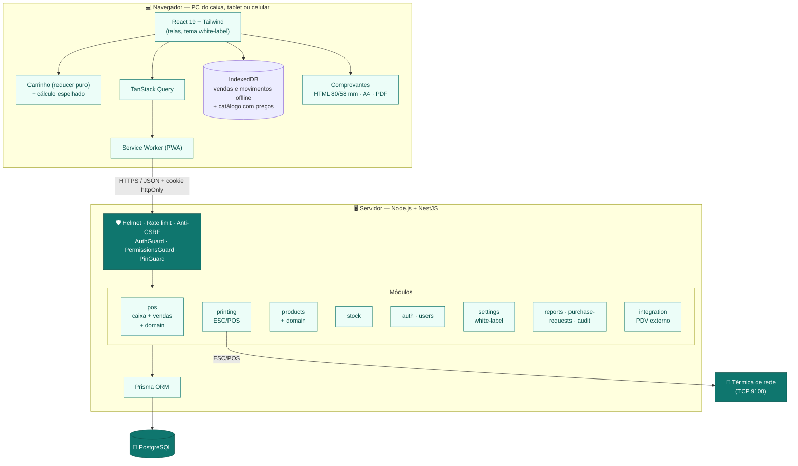

### Camadas de cada módulo

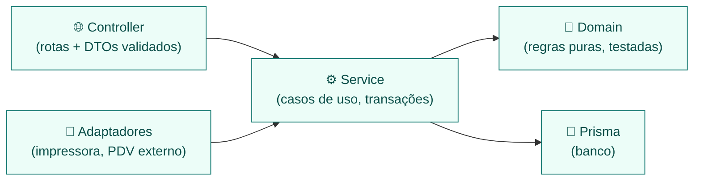

| Decisão | Motivo |
|---|---|
| **Dinheiro em centavos inteiros** | R$ 0,10 + R$ 0,20 dá exatamente R$ 0,30. Nada de erro de ponto flutuante no caixa |
| **Mesmo cálculo no navegador e no servidor** | O caixa precisa calcular offline. Um teste de paridade com 2.000 vendas aleatórias garante resultados idênticos |
| **Venda e baixa de estoque na mesma transação** | Ou grava a venda com todas as baixas, ou não grava nada |
| **ID da venda gerado no caixa (idempotência)** | A sincronização offline e um duplo clique não duplicam vendas nem baixas |
| **Um caixa aberto por terminal (índice único no banco)** | Nem dois cliques simultâneos abrem dois turnos no mesmo terminal |
| **Autorização do supervisor por token** | O gerente libera uma ação com o PIN sem trocar de sessão. O token vale só para aquele operador e aquela ação (e para aquela venda, no desconto) |
| **Livro de movimentações imutável** | Cada entrada e saída é um registro com o saldo resultante, auditável |
| **Domínio puro** (`sale-calculator`, `cash-summary`, `escpos`, `replenishment`) | Mudar uma regra é mudar uma função testada, sem tocar em banco ou tela |
| **White-label por configuração** | Um único código atende vários clientes: só muda o cadastro da marca |
| **Impressão como adaptador** | Trocar de impressora (ou, no futuro, emitir NFC-e) afeta só o módulo de impressão/fiscal |

---

## 🗄️ Modelo de dados

```mermaid
erDiagram
    USERS ||--o{ CASH_SESSIONS : "abre / fecha"
    USERS ||--o{ SALES : "vende"
    USERS ||--o{ CASH_MOVEMENTS : "registra"
    CASH_SESSIONS ||--o{ SALES : "contém"
    CASH_SESSIONS ||--o{ CASH_MOVEMENTS : "sangrias e suprimentos"
    SALES ||--|{ SALE_ITEMS : "itens"
    SALES ||--|{ SALE_PAYMENTS : "pagamentos"
    PRODUCTS ||--o{ SALE_ITEMS : "vendido em"
    PRODUCTS ||--o{ STOCK_MOVEMENTS : "possui"
    CATEGORIES ||--o{ PRODUCTS : "classifica"
    USERS ||--o{ STOCK_MOVEMENTS : "registra"
    PRODUCTS ||--o{ PURCHASE_REQUESTS : "gera"

    CASH_SESSIONS {
        uuid id PK
        string terminal "único aberto por terminal"
        enum status "OPEN, CLOSED"
        decimal openingAmount "troco inicial"
        decimal expectedCash
        decimal countedCash
        decimal difference "falta (−) / sobra (+)"
        json closingSummary "resumo congelado"
    }

    CASH_MOVEMENTS {
        uuid id PK
        enum type "SUPPLY, WITHDRAWAL"
        decimal amount
        string reason "obrigatória"
        uuid authorizedById FK "supervisor"
    }

    SALES {
        uuid id PK "gerado no caixa"
        int number UK "nº do comprovante"
        enum status "COMPLETED, CANCELED"
        decimal grossTotal
        decimal itemsDiscount
        decimal orderDiscount
        decimal total
        decimal paidTotal
        decimal change "troco"
        uuid discountAuthorizedById FK
        json removedItems "itens retirados do cupom"
        boolean offline
        datetime occurredAt
    }

    SALE_ITEMS {
        uuid id PK
        string productName "cópia no momento da venda"
        decimal quantity
        decimal unitPrice
        decimal unitCost "para a margem"
        decimal discount
        decimal total
    }

    SALE_PAYMENTS {
        uuid id PK
        enum method "CASH, PIX, CREDIT_CARD, DEBIT_CARD"
        decimal amount
    }

    PRODUCTS {
        uuid id PK
        string sku UK
        string barcode UK
        decimal costPrice
        decimal salePrice
        decimal currentStock
        decimal reorderPoint "PP"
    }

    USERS {
        uuid id PK
        enum role "ADMIN, MANAGER, STOCKIST, CASHIER"
        string pinHash "Argon2id"
    }
```

| Tabela | Finalidade | Observações |
|---|---|---|
| `cash_sessions` | Turnos de caixa por terminal | Resumo e diferença congelados no fechamento |
| `cash_movements` | Sangrias e suprimentos | Justificativa obrigatória e supervisor que autorizou |
| `sales` · `sale_items` · `sale_payments` | Vendas não fiscais | Itens guardam nome, preço e custo do momento da venda |
| `products` | Catálogo, preços e saldo | Produto com vendas nunca é apagado da lixeira |
| `stock_movements` | Livro de entradas e saídas | Venda: `OUT_SALE`. Cancelamento: `IN_SALE_CANCEL` |
| `users` · `audit_logs` · `settings` | Acesso, rastro e configurações | `settings` guarda a marca, a impressão e as regras do caixa |
| `categories` · `purchase_requests` | Estoque | Iguais à versão anterior |

---

## 🧩 Diagrama de classes

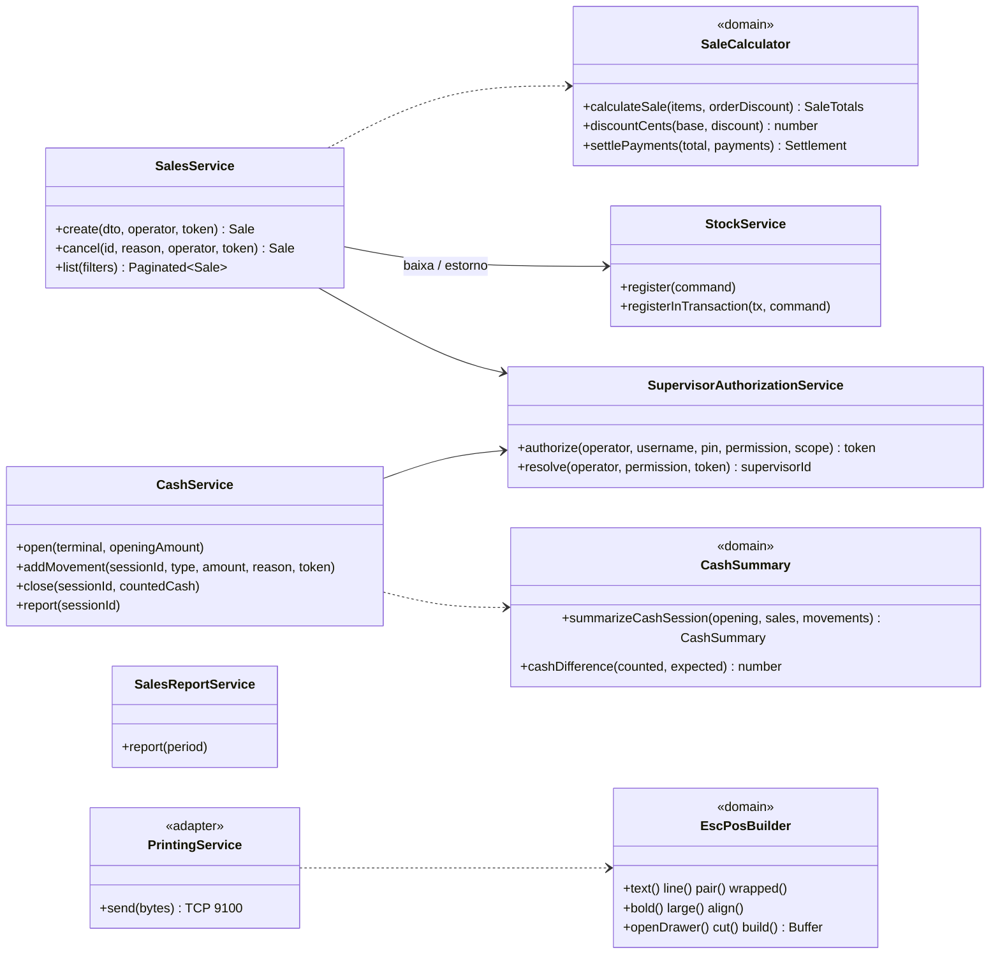

---

## 🔄 Fluxos principais

### Venda no caixa

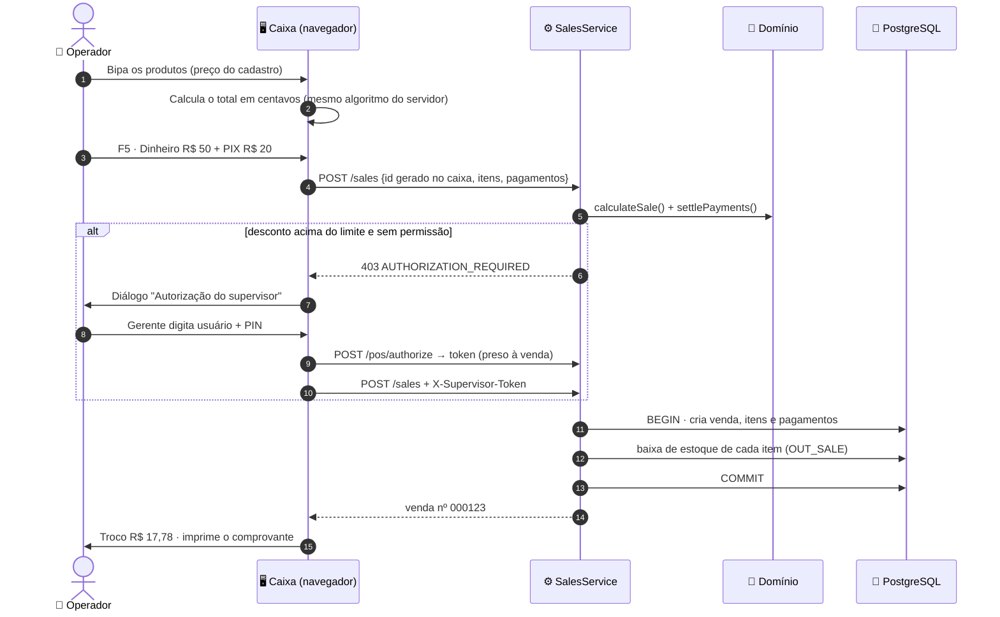

### Venda sem internet

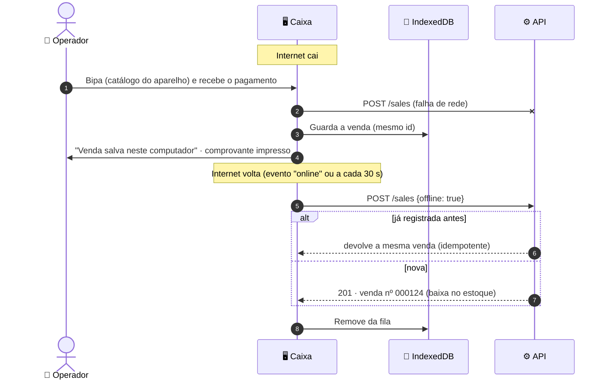

### Fechamento de caixa

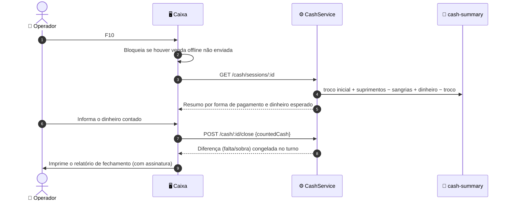

---

## 🚦 Diagramas de estado

### Caixa e venda

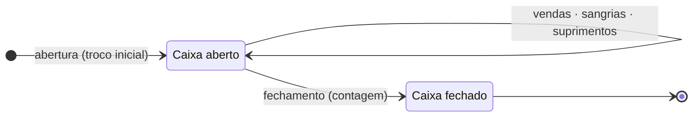

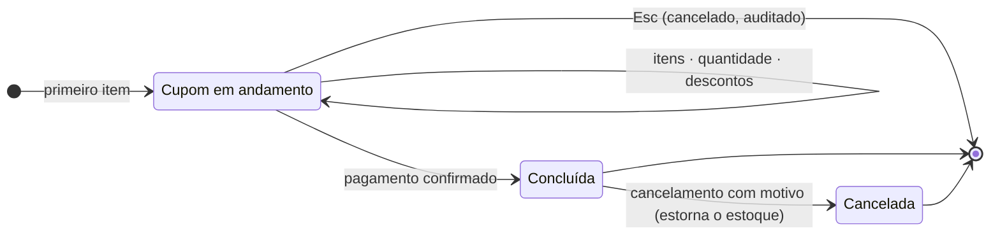

> Só é possível cancelar vendas do caixa **aberto**: depois do fechamento, os valores do turno ficam congelados.

### Solicitação de pedido e produto

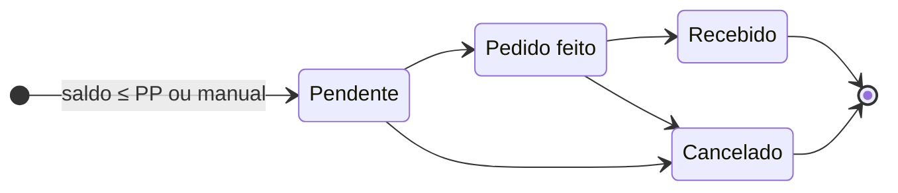

---

## 📐 Regras de negócio

### Caixa

| Regra | Detalhe |
|---|---|
| Total do item | `preço × quantidade − desconto do item` (arredondado ao centavo) |
| Total da venda | `Σ itens − desconto no total` (o desconto no total incide sobre os itens já com desconto) |
| Desconto | Em R$ ou %, nunca maior que o valor. Acima do **limite do operador** (Configurações → Frente de caixa, padrão 0%) exige o gerente |
| Troco | `pago − total`, e só pode sair do **dinheiro** (PIX e cartão não passam do valor que falta) |
| Dinheiro esperado | `troco inicial + suprimentos − sangrias + dinheiro recebido − troco devolvido` |
| Diferença de caixa | `contado − esperado` (negativo é falta, positivo é sobra) |
| Sangria | Justificativa obrigatória e não pode passar do dinheiro esperado na gaveta |
| Preço | Online, o preço tem que ser o do cadastro (se mudou, o caixa pede para bipar de novo). Offline, vale o preço salvo no aparelho e a diferença vai para a auditoria |
| Estoque | Por padrão o caixa vende mesmo com saldo zerado (o produto está na mão do cliente) e avisa. Há a opção de bloquear |
| Vendas offline | Nunca são barradas por saldo e precisam ser enviadas antes do fechamento |

### Reposição (fórmulas do estoque)

| Indicador | Sigla | Fórmula |
|---|:-:|---|
| Estoque Mínimo | **EM** | `Consumo Médio Diário × Tempo de Reposição` |
| Estoque de Segurança | **ES** | `(Consumo Máximo Diário − Consumo Médio Diário) × Tempo de Reposição` |
| Ponto de Pedido | **PP** | `(Consumo Médio Diário × Tempo de Reposição) + ES` |
| Quantidade sugerida | — | `ES + Consumo Médio × (Tempo de Reposição + Dias de Cobertura) − Saldo` |

| Situação | Condição | Cor |
|---|---|:-:|
| 🔴 Sem estoque | saldo ≤ 0 | vermelho |
| 🟠 Crítico | saldo ≤ ES | laranja |
| 🟡 Repor | saldo ≤ PP | amarelo |
| 🟢 Normal | saldo > PP | verde |

### Configurações ajustáveis

| Parâmetro | Padrão |
|---|:-:|
| Desconto máximo do operador sem autorização | 0% |
| Bloquear venda de item sem estoque | Não |
| Papel / conexão da impressora | 80 mm / Windows |
| Imprimir automaticamente ao finalizar | Não |
| Abrir gaveta nas vendas em dinheiro (impressora de rede) | Não |
| Dias na lixeira · cobertura do pedido · estoque negativo em saídas manuais | 15 · 7 · Não |
| PIN em entradas, saídas, cadastro e exclusão | Sim |

---

## 👥 Perfis e permissões

| Ação | 🛡️ Administrador | 👔 Gerente | 📦 Estoquista | 🧾 Operador de caixa |
|---|:-:|:-:|:-:|:-:|
| Abrir/fechar caixa e vender | ✅ | ✅ | — | ✅ |
| Desconto acima do limite | ✅ | ✅ | — | 🔑 com gerente |
| Cancelar venda finalizada (estorna estoque) | ✅ | ✅ | — | 🔑 com gerente |
| Sangria e suprimento | ✅ | ✅ | — | 🔑 com gerente |
| Vendas, caixas e relatórios de vendas | ✅ | ✅ | — | só o turno aberto (reimpressão) |
| Consultar produtos e saldo | ✅ | ✅ | ✅ | ✅ |
| Entradas e saídas de estoque | ✅ | — | ✅ | — |
| **Ajuste manual de estoque** | ✅ | — | — | — |
| Cadastrar produtos, preços e categorias | ✅ | — | ✅ | — |
| Movimentações, pedidos e relatórios de estoque | ✅ | ✅ (consulta) | ✅ | — |
| Usuários, configurações, marca, lixeira e auditoria | ✅ | — | — | — |

🔑 = o operador pede e um gerente autoriza **no próprio caixa** com usuário + PIN, sem trocar de sessão.

> As permissões são verificadas **no servidor** em todas as rotas. Esconder um botão na tela não é a proteção.

---

## 🔒 Segurança

| Ameaça | Proteção |
|---|---|
| Vazamento de senhas | **Argon2id** para senhas e PINs |
| Roubo de sessão (XSS) | Cookie **httpOnly** e **CSP** rígida |
| CSRF | **SameSite=Strict** + cabeçalho anti-CSRF obrigatório |
| Força bruta | Conta bloqueada após 5 erros (senha ou PIN), PIN de supervisor bloqueado por 5 min e **rate limit** por IP |
| Operador "se autorizando" | Token do supervisor assinado, preso ao operador, à permissão e (no desconto) à venda. O avulso é de **uso único** e dura 2 minutos |
| Desconto disfarçado de preço | Online, o servidor exige o preço do cadastro. Offline, a divergência é aceita e **auditada** |
| Venda duplicada | ID gerado no caixa e idempotência no servidor (inclusive em envios simultâneos) |
| Dois caixas no mesmo terminal | Índice único parcial no banco |
| Funcionário desligado | `tokenVersion` derruba as sessões na hora |
| Mass assignment / SQL injection | DTOs com *whitelist* e consultas parametrizadas |
| Logotipo malicioso | Só imagens (PNG/JPEG/WebP/SVG) via data URL, até 150 KB, exibidas como `` |
| Rastreabilidade | **Auditoria** de vendas, descontos, itens removidos, cancelamentos, sangrias, gaveta, reimpressões, autorizações, logins e configurações |
| Senha padrão / fraca | Senhas aleatórias na instalação, troca obrigatória no 1º acesso, política mínima |
| Enumeração de usuários | Mensagem genérica e tempo de resposta igualado |
| Clickjacking, sniffing | Helmet: `frame-ancestors 'none'`, `nosniff`, `Referrer-Policy` |
| Configuração insegura | A API não sobe sem segredo forte (validação com Zod) |
| Banco exposto | PostgreSQL só escuta em `127.0.0.1` |
| Computador compartilhado | O cache offline é apagado no logout |
| Recuperação de senha | Código de 6 dígitos guardado como hash, 15 min de validade, uso único, 5 tentativas, 3 pedidos/hora, resposta genérica e sessões encerradas ao redefinir |
| Senha do e-mail de envio | Criptografada no banco com **AES-256-GCM** (chave derivada do `JWT_SECRET`); nunca sai da API; TLS obrigatório |

### ⚖️ LGPD (Lei nº 13.709/2018)

| Requisito | Como o sistema atende |
|---|---|
| Transparência (art. 6º, VI, e art. 9º) | **Termo de Uso e Política de Privacidade** em `/termos`, com controlador, encarregado, finalidades, bases legais, compartilhamento e retenção |
| Ciência do titular | Aceite obrigatório no 1º acesso, **versionado** (`TERMS_VERSION`): se o texto mudar, todos aceitam de novo. A API bloqueia o uso até o aceite |
| Clientes (PDV) | Dados pessoais do cliente só com o **consentimento registrado** (data e canal); exportação (JSON) e anonimização a pedido do titular, mantendo as vendas sem identificá-lo; cache de clientes do caixa apagado no logout |
| Minimização (art. 6º, III) | Só nome, login, e-mail (opcional, exceto admin) e auditoria. IP apagado da auditoria após **12 meses**; códigos de recuperação após 1 dia |
| Acesso e portabilidade (art. 18, II e V) | “Baixar meus dados” em Meu perfil (JSON com cadastro, auditoria e operações) |
| Correção (art. 18, III) | O próprio usuário corrige o e-mail; o administrador corrige o nome |
| Eliminação/anonimização (art. 18, IV e VI) | “Anonimizar dados” para usuários desativados: apaga nome, login, e-mail, credenciais e IPs, mantendo o histórico do estoque sem identificação |
| Encarregado (art. 41) | Nome e e-mail configuráveis em Configurações › Empresa e privacidade |
| Segurança (art. 46) | Medidas da tabela acima |

> O texto do termo fica em [`TermsContent.tsx`](apps/web/src/features/legal/TermsContent.tsx). Ele é um modelo e deve ser revisado por um profissional jurídico antes do uso definitivo.

---

## 🔌 API

Prefixo `/api`. Autenticação por cookie de sessão. Quando a ação exige um supervisor, a API responde `403 AUTHORIZATION_REQUIRED` e o caixa repete a requisição com `X-Supervisor-Token`.

### Frente de caixa

| Método | Rota | Permissão | Descrição |
|---|---|---|---|
| `POST` | `/auth/login` | pública | Login (cria o cookie de sessão) |
| `POST` | `/auth/logout` | logado | Encerra e revoga sessões |
| `GET` | `/auth/me` | logado | Perfil e permissões |
| `POST` | `/auth/change-password` · `/auth/pin` | logado | Troca a senha / define o PIN (no 1º acesso: + e-mail e aceite do termo) |
| `GET` | `/auth/recovery` | pública | Se a recuperação por e-mail está ativa |
| `POST` | `/auth/forgot-password` · `/auth/reset-password` | pública | Envia o código por e-mail / redefine a senha com o código |
| `POST` | `/auth/accept-terms` | logado | Aceite da versão atual do termo |
| `PATCH` | `/auth/profile` | logado | Corrige o próprio e-mail (com a senha atual) |
| `GET` | `/auth/my-data` | logado | Exporta os próprios dados pessoais (LGPD) |
| `GET` | `/legal` | pública | Versão do termo e dados da empresa |
| `GET` | `/products` | product:read | Lista (busca, situação, categoria, paginação) |
| `GET` | `/products/lookup?code=` | product:read | Busca exata por SKU ou EAN (bipagem) |
| `POST` `PATCH` | `/products` · `/products/:id` | product:write + PIN | Cadastrar / editar |
| `DELETE` | `/products/:id` | product:delete + PIN | Enviar para a lixeira |
| `GET` `POST` `DELETE` | `/trash` · `/trash/:id/restore` · `/trash/:id` | trash:manage | Lixeira |
| `POST` | `/stock/entries` · `/stock/exits` | stock:in / stock:out + PIN | Registrar movimentação |
| `GET` | `/stock/movements` | movement:read | Histórico com filtros |
| `GET` `POST` `PATCH` | `/purchase-requests` · `/:id/status` | purchase:* | Solicitações de pedido |
| `GET` | `/reports/dashboard` · `/reports/movements` | product:read / report:read | Painel e relatório por período |
| `GET` `POST` `PATCH` | `/users` · `/users/:id/reset-password` · `/reset-pin` | user:manage | Usuários |
| `GET` `PATCH` | `/settings` | settings:manage | Configurações |
| `GET` `PUT` · `POST` | `/settings/mail` · `/settings/mail/test` | settings:manage | E-mail de envio (senha criptografada) / teste |
| `PUT` | `/settings/company` | settings:manage | Dados da empresa e do encarregado |
| `POST` | `/users/:id/anonymize` | user:manage | Anonimiza um usuário desativado (LGPD) |
| `GET` | `/audit` | audit:read | Auditoria |
| `GET` | `/integration/pdv/products/:code/availability` | X-API-Key | PDV consulta estoque |
| `POST` | `/integration/pdv/sales` | X-API-Key | PDV envia venda (idempotente por `externalId`) |
| `POST` | `/auth/pin-login` | pública | Troca rápida de operador (usuário + PIN) |
| `POST` | `/pos/authorize` | pos:sell | Supervisor libera uma ação (usuário + PIN) → token |
| `GET` | `/cash/current?terminal=` | pos:sell | Turno aberto do terminal com o resumo |
| `POST` | `/cash/open` | pos:sell | Abre o caixa (troco inicial) |
| `POST` | `/cash/:id/movements` | pos:sell (+ cash:movement ou supervisor) | Sangria / suprimento |
| `POST` | `/cash/:id/close` | pos:sell | Fecha o caixa (dinheiro contado) |
| `GET` | `/cash/sessions` · `/cash/sessions/:id` | sales:read · pos:sell | Histórico e relatório do turno |
| `POST` | `/sales` | pos:sell (+ pos:discount ou supervisor) | Registra a venda (idempotente pelo `id`) |
| `GET` | `/sales` · `/sales/:id` | pos:sell | Vendas (o operador só vê o turno aberto) |
| `POST` | `/sales/:id/cancel` | pos:sell (+ pos:cancel ou supervisor) | Cancela e estorna o estoque |
| `POST` | `/sales/:id/reprint` · `/sales/abandon` | pos:sell | Auditoria de reimpressão e de cupom cancelado |
| `GET` | `/sales/report?from=&to=` | sales:read | Relatório de vendas do período |
| `POST` | `/printing/sales/:id` · `/cash-sessions/:id` · `/cash-movements/:id` | pos:sell | Impressão ESC/POS na térmica de rede |
| `POST` | `/printing/drawer` · `/printing/test` | pos:sell · settings:manage | Abrir gaveta · página de teste |
| `GET` | `/settings/branding` | pública | Marca da loja (white-label) |
| `GET` `POST` `PATCH` | `/customers` · `/customers/:id` | customer:read / customer:write | Clientes (busca por nome, CPF ou telefone) |
| `GET` `POST` | `/customers/:id/export` · `/customers/:id/anonymize` | customer:manage | LGPD: exportar e apagar dados pessoais |
| `GET` `POST` `PATCH` `DELETE` | `/payment-methods` | logado / settings:manage | Formas de pagamento |

<details>
<summary><b>Exemplo: registrar uma venda</b></summary>

```http
POST /api/sales
Content-Type: application/json
X-Requested-With: XMLHttpRequest

{
  "id": "6f1c0e3a-5b8e-4a77-9f37-2b1d1c2e9a10",
  "sessionId": "b1f0…",
  "occurredAt": "2026-10-15T14:32:00.000Z",
  "items": [
    { "productId": "…", "quantity": 2, "unitPrice": 5.29 },
    { "productId": "…", "quantity": 0.455, "unitPrice": 16.90, "discount": { "type": "PERCENT", "value": 5 } }
  ],
  "orderDiscount": { "type": "AMOUNT", "value": 1 },
  "payments": [
    { "method": "PIX", "amount": 10 },
    { "method": "CASH", "amount": 20 }
  ]
}
```

Reenviar o mesmo `id` devolve a mesma venda, sem duplicar.

</details>

### Estoque e administração

| Método | Rota | Permissão | Descrição |
|---|---|---|---|
| `POST` `GET` | `/auth/login` · `/auth/logout` · `/auth/me` | — | Sessão |
| `GET` `POST` `PATCH` `DELETE` | `/products` · `/products/lookup` · `/products/:id` | product:* | Catálogo (com preços) |
| `POST` | `/stock/entries` · `/stock/exits` | stock:in / stock:out (+ stock:adjust nos ajustes) + PIN | Movimentações |
| `GET` | `/stock/movements` | movement:read | Histórico |
| `GET` `POST` `PATCH` | `/purchase-requests` | purchase:* | Solicitações de pedido |
| `GET` | `/reports/dashboard` · `/reports/movements` | product:read / report:read | Painel e relatório de estoque |
| `GET` `POST` `PATCH` | `/users` | user:manage | Usuários |
| `GET` `PATCH` | `/settings` | — / settings:manage | Configurações (marca, impressão, caixa) |
| `GET` | `/audit` | audit:read | Auditoria |
| `GET` `POST` | `/integration/pdv/*` | X-API-Key | Integração com um PDV externo (opcional) |

---

## 🚀 Como rodar


> 📘 O passo a passo completo, com telas, está no **[Manual de Uso (PDF)](apps/web/public/manual-de-uso.pdf)**, que também abre pelo menu lateral do sistema.

### Opção A · Aplicativo para Windows

O app abre em **janela própria** (sem barra de endereço) e já traz tudo embutido: banco PostgreSQL, API e telas. Não é preciso instalar Node.js nem nada além dele.

| Requisito | Mínimo |
|---|---|
| Sistema | Windows 10 ou 11, 64 bits |
| Memória | 4 GB de RAM (recomendado 8 GB) |
| Disco | ~1 GB para o programa |
| Leitor de código de barras | Qualquer leitor USB que funcione como teclado |
| Internet | Não é necessária (só para o backup no Google Drive e o e-mail de recuperação) |

#### Duas formas de usar

| | A) Instalado (recomendado) | B) Sem instalar |
|---|---|---|
| Como abre | Atalho **VL Estoque** na Área de Trabalho e no Menu Iniciar | Dois cliques em `VL Estoque.exe` |
| Onde fica | `%LOCALAPPDATA%\Programs\vl-estoque` | `apps\desktop\release\win-unpacked` (recriada a cada `npm run dist`) |
| Indicado para | Computador da loja | Desenvolvimento e testes |
| Dados | As duas usam os **mesmos dados** (`%LOCALAPPDATA%\VLEstoque`) | ← |

#### Instalar

1. Baixe o instalador **[VL-Estoque-Setup-1.3.1.exe](https://github.com/tassiocarvalho/vl-estoque/releases/latest/download/VL-Estoque-Setup-1.3.1.exe)** (ou gere com `npm run dist`) e dê dois cliques.
2. Se aparecer **“O Windows protegeu o computador”**, clique em **Mais informações → Executar assim mesmo**. O aviso aparece porque o instalador não tem assinatura digital paga.
3. Mantenha a pasta sugerida, clique em **Instalar** e depois em **Concluir**. Não precisa de senha de administrador do Windows (instalação por usuário).

#### Usar sem instalar

1. Abra `sistema-estoque\apps\desktop\release\win-unpacked` e dê dois cliques em **VL Estoque.exe**.
2. Atalho opcional: botão direito no arquivo → **Enviar para → Área de trabalho (criar atalho)**.

#### Ao abrir

1. Aparece a tela de carregamento verde: *Iniciando o banco de dados → Atualizando o banco de dados → Iniciando o sistema* (10 a 30 segundos).
2. **Primeira abertura:** o app **entra sozinho como `admin`** e pede a **senha pessoal, o PIN, o e-mail de recuperação e o aceite do termo de uso**. Ninguém precisa ver a senha provisória.
3. O **Manual de uso** fica no menu lateral e aparece num aviso de boas-vindas no painel.
4. Enquanto o app está aberto, o sistema também funciona no navegador em **http://localhost:3030** e no celular (mesma rede) em `http://IP-DO-COMPUTADOR:3030`.
5. Para fechar, clique no **X**: o app faz o último backup e desliga o banco com segurança. Clicar no atalho com o app aberto só traz a janela para a frente.

#### Atualizar e desinstalar

- **Atualizar:** feche o app e instale a versão nova **por cima** (ou use a nova pasta `win-unpacked`). Ao abrir, *Atualizando o banco de dados...* ajusta os dados sozinho.
- **Desinstalar:** Configurações do Windows → Aplicativos → **VL Estoque** → Desinstalar. Os dados em `%LOCALAPPDATA%\VLEstoque` são mantidos.

| Item | Onde fica |
|---|---|
| Programa instalado | `%LOCALAPPDATA%\Programs\vl-estoque` |
| Dados do estoque | `%LOCALAPPDATA%\VLEstoque\pgdata` (preservados ao desinstalar) |
| Segredos gerados na instalação | `%LOCALAPPDATA%\VLEstoque\config.json` (a senha provisória é apagada após o primeiro acesso) |
| Logs | `%LOCALAPPDATA%\VLEstoque\logs` |
| Backups automáticos | `Meu Drive\VL Estoque - Backups` no Google Drive (ou `%LOCALAPPDATA%\VLEstoque\backups` sem o Drive) |
| Portas usadas | `3030` (sistema) e `5434` (banco, só no próprio computador) |

#### Se não abrir

| Sintoma | Solução |
|---|---|
| “Não foi possível iniciar o V&L Estoque” | Abra de novo ou reinicie o computador. A mensagem mostra o arquivo de log com os detalhes |
| Carregamento demorado | Antivírus podem atrasar a primeira abertura: aguarde até 1 minuto ou adicione a pasta do programa às exceções |
| Porta 3030 ou 5434 ocupada | Feche o programa que usa a porta ou reinicie o computador |
| Celular não acessa | No aviso do Firewall do Windows, clique em **Permitir** (redes privadas) |


> ℹ️ O instalador publicado (1.3.1) é a versão só de estoque. Para o aplicativo com a frente de caixa, gere um instalador novo desta branch com `npm run dist`.

Para atualizar o manual, edite [`docs/manual/manual.html`](docs/manual/manual.html) e rode `npm run manual`.

### Opção B · Pelo código-fonte

#### O que você precisa

| Item | Detalhe |
|---|---|
| Computador principal | Windows 10/11 (também roda em macOS e Linux), 4 GB de RAM. Fica ligado enquanto a loja usa o sistema |
| **Node.js 22 ou mais novo** | [nodejs.org](https://nodejs.org) → versão LTS → instalar com "Avançar". É a **única** instalação necessária |
| Banco de dados | Nada a instalar: o PostgreSQL vem embutido |
| Navegador | Edge ou Chrome |

#### Instalação (uma vez só)

Abra o **Prompt de Comando** (tecla Windows → `cmd` → Enter) na pasta do projeto e rode:

```bat
cd "C:\caminho\para\o\projeto"

:: 1. Instala tudo, gera as senhas, cria o banco e o usuário admin
npm.cmd run setup

:: 2. (opcional) 22 produtos de exemplo, com preços, para treinar
npm.cmd run db:demo -w @vl/api

:: 3. Gera a versão de uso
npm.cmd run build
```

No fim do `setup` aparece a **senha provisória do `admin`**. Anote, porque ela também fica em `apps/api/.env` (`ADMIN_INITIAL_PASSWORD`). O sistema pede a troca no primeiro acesso.

> 💡 **Por que `npm.cmd`?** No PowerShell, `npm` pode dar o erro *"a execução de scripts foi desabilitada neste sistema"*. `npm.cmd` (ou usar o Prompt de Comando) evita isso. Para liberar o `npm` de vez: `Set-ExecutionPolicy -Scope CurrentUser RemoteSigned` e responda **S**.

### Uso no dia a dia

| Ação | Como |
|---|---|
| **Ligar** | Dois cliques em **`iniciar-sistema.bat`**. Abre a janela *SuaLojaAqui* e, em seguida, o navegador em **http://localhost:3000** |
| **Desligar** | Fechar a janela *SuaLojaAqui* (o banco desliga com segurança) |
| **Ligar com o Windows** | Windows + R → `shell:startup` → colocar um atalho do `iniciar-sistema.bat` |
| **Outros PCs, tablets e celulares** | Na mesma rede: `http://IP-DO-COMPUTADOR:3000` (veja o IP com `ipconfig`). Se não abrir, libere a porta TCP 3000 no Firewall do Windows |
| **Caixa sem janela de impressão** | Atalho: `msedge.exe --kiosk-printing --app=http://localhost:3000/caixa` |

### Primeiros passos na loja

1. Entre como `admin`, troque a senha e crie seu **PIN** em *Meu perfil*.
2. **Configurações → Identidade da loja:** nome, logotipo, cor, CNPJ e endereço. **→ Impressão:** papel e impressora, depois *Imprimir página de teste*.
3. **Produtos:** cadastre com **preço de venda** (e de custo, para a margem). "Controlar consumo e reposição" é opcional por produto.
4. **Usuários:** crie operadores de caixa e gerentes, todos **com PIN**.
5. No computador do caixa, entre como operador. Ele cai direto na frente de caixa: informe o troco inicial e **abra o caixa**.

### Para desenvolvedores

| Comando | Descrição |
|---|---|
| `npm run dev` | Banco, API e front com recarga automática (http://localhost:5173) |
| `npm run build` · `npm start` | Build e execução em produção (http://localhost:3000) |
| `npm test` | Testes das regras de negócio (Vitest) |
| `npm run typecheck` | Verificação de tipos da API e do front |
| `npm run db:deploy -w @vl/api` | Aplica as migrations (rode após atualizar o sistema) |
| `npm run db:demo -w @vl/api` | Dados de demonstração |
| `npm run db:stop -w @vl/api` | Desliga o banco embutido |

### Problemas comuns

| Sintoma | Solução |
|---|---|
| *"a execução de scripts foi desabilitada"* | Use `npm.cmd` em vez de `npm` (veja acima) |
| `P1000: Authentication failed` | O `apps/api/.env` tem uma senha diferente da do banco que já existe no PC. Use o `.env` antigo **ou** aponte `DB_DATA_DIR` no `.env` para uma pasta nova e rode `npm.cmd run db:deploy -w @vl/api` e `npm.cmd run db:seed -w @vl/api` |
| Porta 3000 em uso | O sistema já está ligado em outra janela: feche-a ou use a que está aberta |
| Tela antiga depois de atualizar | `Ctrl+F5` no navegador (fora do caixa) |
| Celular não acessa | Mesmo Wi-Fi, IP do computador principal e porta 3000 liberada no firewall |

> 💾 Os dados ficam em `%LOCALAPPDATA%\vl-estoque\pgdata` (ou na pasta de `DB_DATA_DIR`), **fora do OneDrive** de propósito, porque a sincronização de arquivos corrompe bancos de dados. **Backup:** desligue o sistema e copie essa pasta **e** o `apps/api/.env` para um HD externo. Para publicar na nuvem, troque a `DATABASE_URL`, use **HTTPS** e defina `COOKIE_SECURE=true`.

> 🖥️ **App desktop:** o instalador do Windows (`apps/desktop`) ainda é o da versão anterior, só de estoque. A frente de caixa roda pelo navegador (instalável como PWA).

---

## 🧪 Testes

| Suíte | O que garante |
|---|---|
| `sale-calculator.spec.ts` | Descontos (R$ e %), venda por peso, ausência de erro de ponto flutuante, pagamentos múltiplos e troco só em dinheiro |
| `sale-calculator.parity.spec.ts` | O cálculo do navegador (vendas offline) é **idêntico** ao do servidor em 2.000 vendas aleatórias |
| `cash-summary.spec.ts` | Dinheiro esperado, totais por forma de pagamento, vendas canceladas e diferença de caixa |
| `escpos.spec.ts` | Acentuação PC860, layout da bobina, gaveta e corte de papel |
| `replenishment.spec.ts` | Fórmulas de reposição (EM, ES, PP e quantidade sugerida) |

```bash
npm test
```

---

## 🗂️ Estrutura de pastas

```
├── apps/
│   ├── api/                              # Back-end (NestJS)
│   │   ├── prisma/                       # schema, migrations, seed, demo
│   │   └── src/
│   │       ├── common/                   # auth, permissões, segurança, erros, ids
│   │       └── modules/
│   │           ├── pos/                  # 🧾 caixa, vendas, relatório, autorização do supervisor
│   │           │   └── domain/           # 🧠 cálculo da venda + fechamento de caixa (+ testes)
│   │           ├── printing/             # 🖨️ ESC/POS (+ testes) e envio para a térmica de rede
│   │           ├── settings/             # 🎨 white-label, impressão e regras do caixa
│   │           ├── products/domain/      # 🧠 EM · ES · PP (+ testes)
│   │           ├── products/ stock/ purchase-requests/ reports/
│   │           ├── auth/ users/ audit/ categories/
│   │           └── integration/          # 🔌 PDV externo (opcional)
│   ├── web/                              # Front-end (React PWA)
│   │   └── src/
│   │       ├── features/pos/             # 🖥️ frente de caixa (carrinho, pagamento, caixa)
│   │       ├── features/sales/           # 📈 vendas e caixas
│   │       ├── features/printing/        # 🧾 comprovantes: HTML 80/58 mm, A4 e PDF
│   │       ├── features/branding/        # 🎨 marca e tema claro/escuro
│   │       └── features/…                # estoque, usuários, configurações...
│   └── desktop/                          # App Windows (versão anterior, só estoque)
├── docs/
│   ├── manual/                           # 📘 Fonte do manual (HTML); o PDF sai em apps/web/public/manual-de-uso.pdf (npm run manual)
│   ├── DRS-PDV.md                        # Requisitos v1 e rastreabilidade
│   ├── DRS-v2.md                         # Backlog priorizado da próxima versão
│   └── screenshots/
└── scripts/setup.mjs
```

### Stack

| Camada | Tecnologias |
|---|---|
| **Front-end** | React 19 · TypeScript · Vite 7 · Tailwind CSS 4 · TanStack Query · React Hook Form + Zod · React Router 7 · Lucide · jsPDF |
| **PWA / Offline** | vite-plugin-pwa (Workbox) · IndexedDB (idb-keyval) |
| **Back-end** | Node.js 24 · NestJS 11 · class-validator · @nestjs/schedule |
| **Banco** | PostgreSQL 18 · Prisma 6 |
| **Segurança** | Argon2id · JWT (cookie httpOnly) · Helmet · @nestjs/throttler |
| **Testes** | Vitest |

---

## 🧭 Próximas etapas

O backlog completo, com prioridades, fases e critérios de aceite, está no **[DRS v2](docs/DRS-v2.md)**. Destaques:

- [ ] **Módulo fiscal** (NFC-e/SAT) como adaptador separado, mantendo o PDV não fiscal.
- [ ] **App desktop do PDV** (Electron), com impressão silenciosa sem `--kiosk-printing`.
- [ ] **TEF** (maquininha integrada) e **PIX dinâmico** com QR Code no caixa.
- [ ] **Etiquetas de balança** (EAN-13 com prefixo 2, com peso ou preço embutido).
- [ ] Ficha técnica da padaria (baixa de insumos ao produzir).

---

<div align="center">
<sub>SuaLojaAqui · PDV não fiscal e gestão de estoque · 2026</sub>
</div>
