<div align="center">

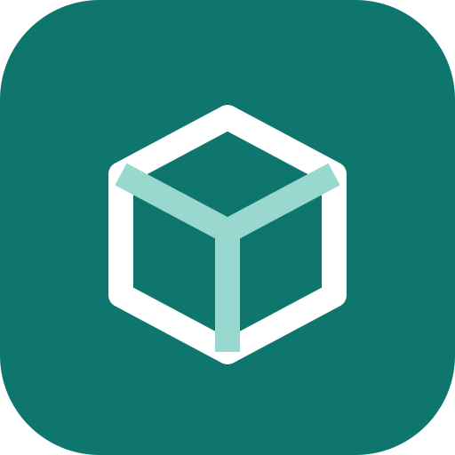

# V&L Estoque

**Sistema de gestão de estoque para a V&L Mercadinho e Panificadora**

Entradas e saídas pela bipagem · Alertas automáticos de reposição · Relatórios · Funciona sem internet


<a href="https://github.com/tassiocarvalho/vl-estoque/releases/latest/download/VL-Estoque-Setup-1.3.0.exe"></a>

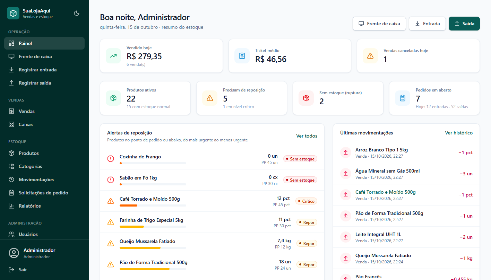

</div>

---

## 📑 Sumário

1. [Visão geral](#-visão-geral)
2. [Funcionalidades](#-funcionalidades)
3. [Telas](#-telas)
4. [Casos de uso](#-casos-de-uso)
5. [Arquitetura](#-arquitetura)
6. [Modelo de dados](#-modelo-de-dados)
7. [Diagrama de classes](#-diagrama-de-classes)
8. [Fluxos principais (sequência)](#-fluxos-principais)
9. [Estados](#-diagramas-de-estado)
10. [Regras de negócio e fórmulas](#-regras-de-negócio)
11. [Perfis e permissões](#-perfis-e-permissões)
12. [Segurança](#-segurança)
13. [API](#-api)
14. [Como rodar](#-como-rodar)
15. [Estrutura de pastas](#-estrutura-de-pastas)
16. [Pendências com o cliente](#-pendências-com-o-cliente)

---

## 🎯 Visão geral

O sistema substitui o controle manual de estoque do mercadinho e da panificadora. Cada mercadoria que **entra** (pedido recebido, retorno) ou **sai** (venda, perda, ajuste) é registrada pela **bipagem do código de barras**. O sistema mantém o saldo atualizado, calcula os indicadores de reposição e **avisa a gestão quando é hora de pedir**.

| Requisito do documento | Como foi atendido |
|---|---|
| Cadastro de mercadorias (nome, SKU, EAN, categoria, unidade, consumo e prazo) | Cadastro completo, com prévia ao vivo dos indicadores |
| Edição e exclusão com recuperação por 15 dias | Lixeira com prazo configurável e limpeza automática diária |
| Entrada de itens já cadastrados por SKU ou bipagem | Tela de entrada focada no leitor de código de barras |
| Saldo total e por item | Lista de produtos, busca por nome, SKU ou EAN, e painel |
| Alerta de estoque de segurança e solicitação de pedido | Solicitação automática ao atingir o Ponto de Pedido |
| Cálculo de PP, EM e ES | Domínio isolado e testado (`replenishment.ts`) |
| Relatórios diários, semanais e mensais (estoque parado, ruptura) | Relatórios por período, com exportação para Excel e impressão |
| Integração com o sistema de caixa | API de integração com chave (consulta de estoque e baixa de vendas) |
| Senha para operações, controle de acesso | Usuários com perfis, PIN pessoal e auditoria |
| Nuvem, sem perda de dados com queda de internet ou energia | Banco transacional, fila offline com sincronização automática |
| Rápido em PC básico com Windows | Carregamento sob demanda e buscas indexadas |
| Acesso por vários dispositivos, offline | PWA responsiva (PC, tablet e celular), instalável |

---

## ✨ Funcionalidades

| Módulo | O que faz |
|---|---|
| 📦 **Produtos** | Cadastro, edição, busca, filtros por situação e categoria, histórico por produto |
| 🗂️ **Categorias** | Categorias e subcategorias (vêm prontas para mercadinho e padaria) |
| ⬇️ **Entradas** | Pedido recebido, retorno ao estoque e ajuste, pela bipagem |
| ⬆️ **Saídas** | Venda, perda/quebra/vencimento e ajuste, com **registro rápido** (1 bip = 1 unidade) |
| 🔔 **Reposição** | EM, ES e PP calculados automaticamente, com solicitação de pedido gerada sozinha |
| 📋 **Pedidos** | Fluxo Pendente → Pedido feito → Recebido (ou Cancelado), com impressão da lista |
| 📊 **Relatórios** | Por período: movimentação por produto, estoque parado, rupturas e solicitações. Exporta CSV |
| 🗑️ **Lixeira** | Recupera produtos excluídos dentro do prazo, depois apaga automaticamente |
| 👥 **Usuários** | Administrador, Estoquista e Caixa, com senha provisória, PIN, e-mail e bloqueio |
| 🔑 **Esqueci minha senha** | Código de 6 números por e-mail (Gmail com senha de app ou outro SMTP), válido por 15 min |
| ⚖️ **LGPD** | Termo de Uso e Política de Privacidade com aceite versionado, “Baixar meus dados”, anonimização e retenção automática |
| 🛡️ **Auditoria** | Quem fez o quê e quando, inclusive tentativas de login erradas |
| ⚙️ **Configurações** | Regras ajustáveis sem programação |
| 📴 **Offline** | Registra sem internet e sincroniza quando a conexão volta |
| 🔌 **Integração PDV** | O caixa consulta o estoque e envia as vendas automaticamente |

---

## 🖼️ Telas

| Login | Produtos |
|:-:|:-:|
| 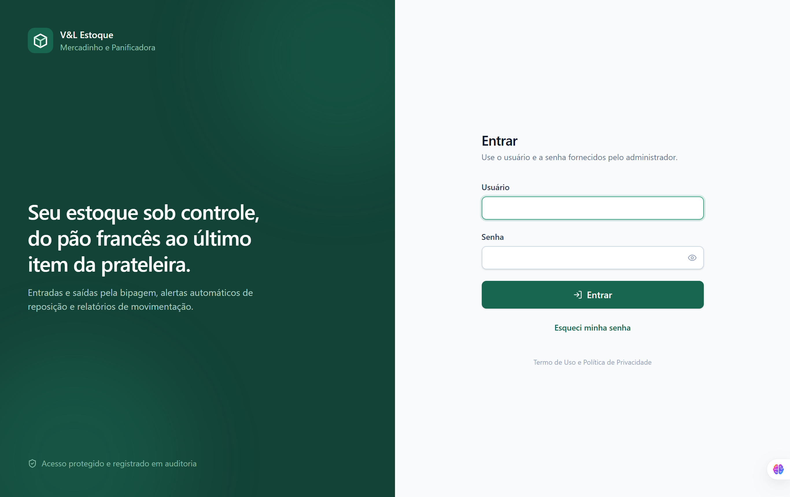 | 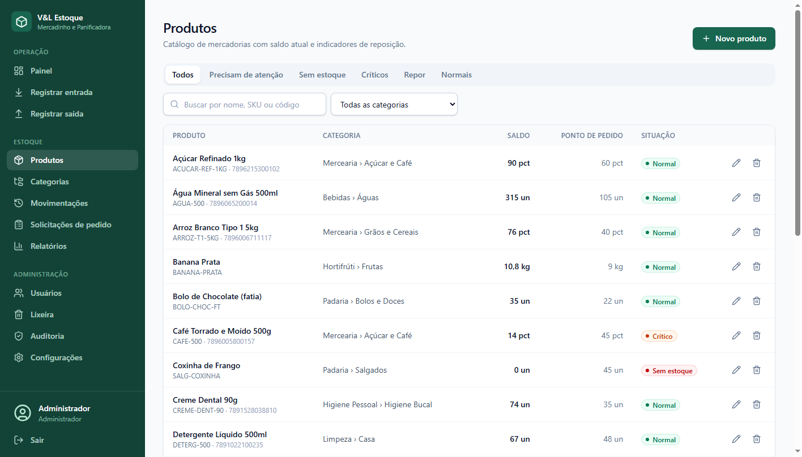 |
| **Registrar saída (bipagem)** | **Cadastro com indicadores calculados** |
| 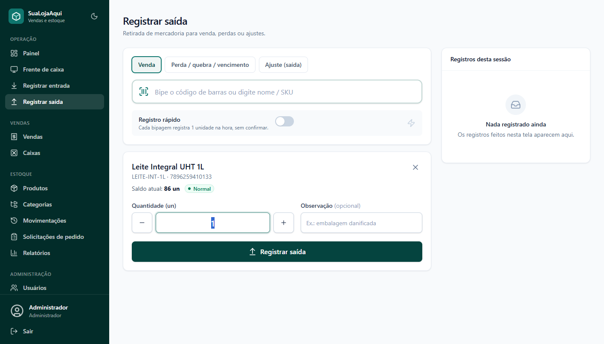 | 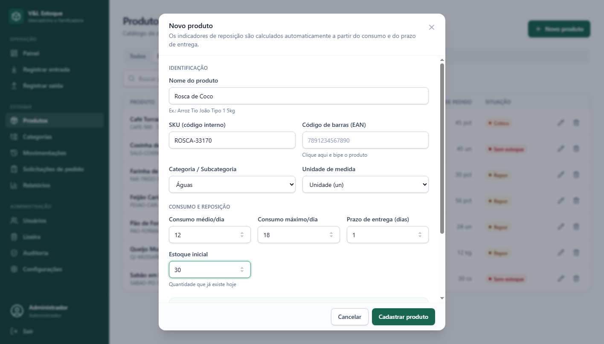 |
| **Detalhe do produto** | **Relatórios** |
| 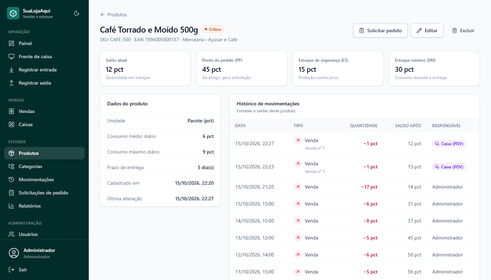 | 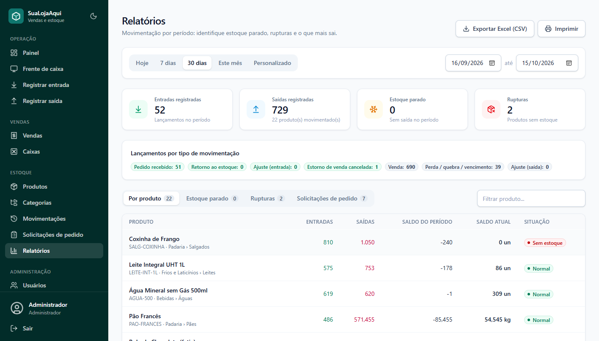 |
| **Solicitações de pedido** | **Modo offline** |
| 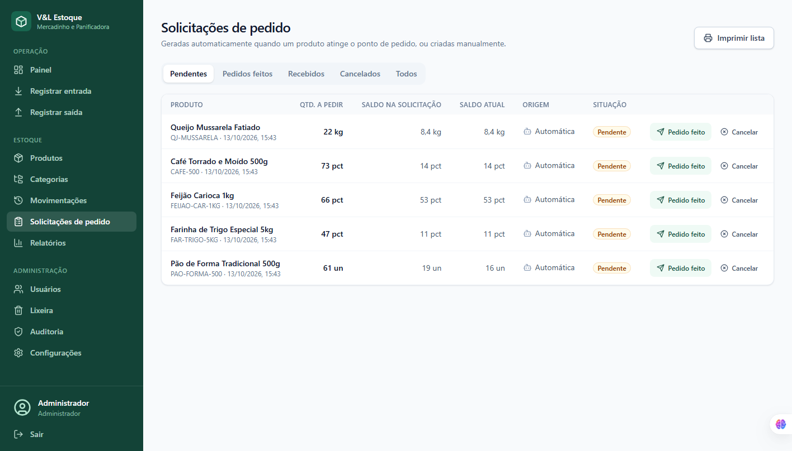 | 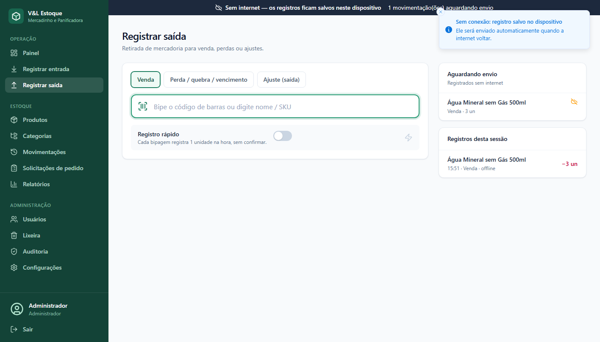 |
| **Configurações** | **Celular** |
| 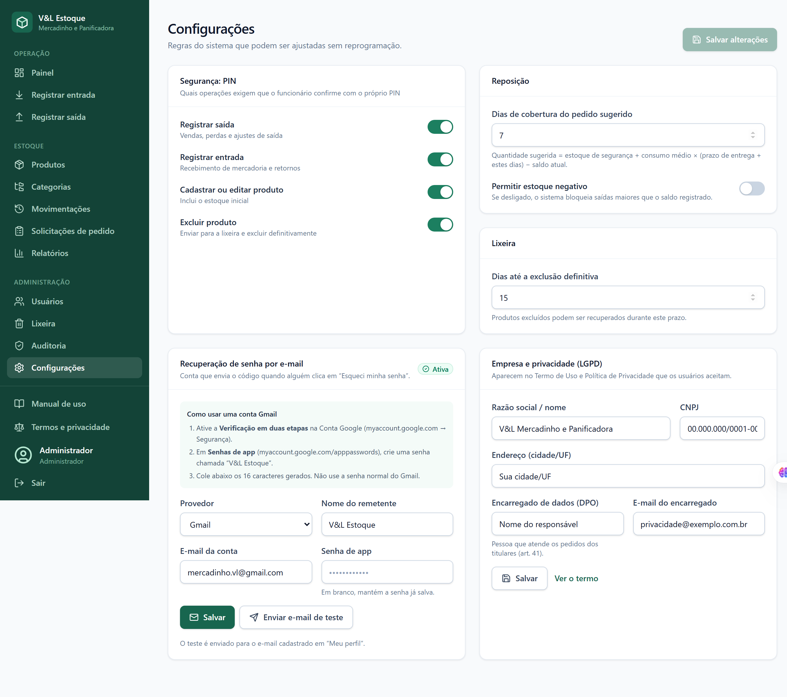 | 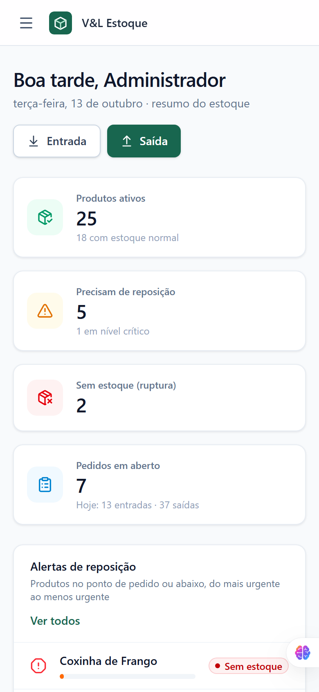 &nbsp; 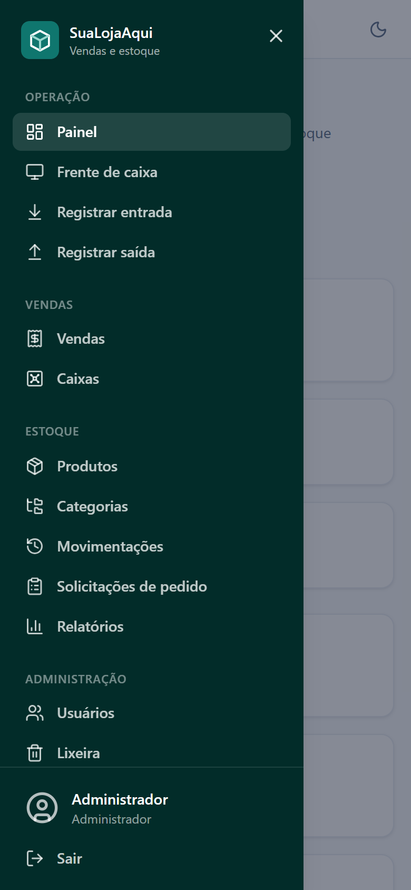 |

---

## 🧑‍🤝‍🧑 Casos de uso

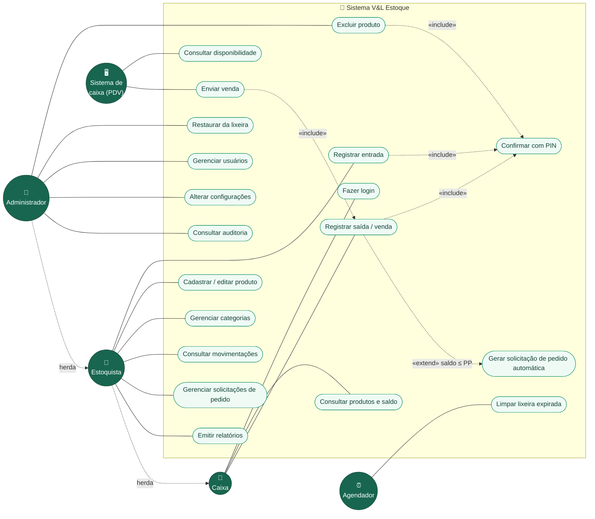

### Descrição dos casos de uso principais

| ID | Caso de uso | Ator | Fluxo principal | Regras |
|---|---|---|---|---|
| UC03 | **Registrar saída** | Caixa+ | 1. Bipa o produto · 2. Informa a quantidade · 3. Confirma com PIN · 4. O sistema baixa o saldo | Bloqueia saldo insuficiente (configurável). Sem internet, guarda na fila |
| UC04 | **Registrar entrada** | Estoquista+ | 1. Bipa · 2. Escolhe o tipo (pedido ou retorno) · 3. Quantidade · 4. PIN | Soma ao saldo e grava no histórico |
| UC05 | **Cadastrar produto** | Estoquista+ | 1. Preenche os dados · 2. Vê EM, ES e PP calculados · 3. PIN | SKU e EAN únicos, consumo máximo ≥ médio |
| UC15 | **Solicitação automática** | Sistema | Após uma saída, se saldo ≤ PP e não há pedido em aberto, cria a solicitação | Quantidade sugerida pela fórmula de cobertura |
| UC10 | **Excluir produto** | Admin | 1. Confirma · 2. PIN · 3. O produto vai para a lixeira | Recuperável por N dias (padrão 15) |
| UC17 | **Limpar lixeira** | Agendador | Todo dia às 3h, apaga definitivamente o que expirou | Apaga também o histórico do produto |
| UC12 | **Gerenciar usuários** | Admin | Cria com senha provisória, edita, desativa, redefine senha ou PIN | Sempre ao menos 1 admin ativo |
| UC19 | **Enviar venda (PDV)** | PDV | Envia o cupom com os itens, e o sistema dá baixa | Idempotente pelo `externalId` |

---

## 🏗️ Arquitetura

**Monólito modular** com domínio isolado. É simples de operar num PC do mercadinho e cada módulo pode evoluir sem afetar os outros.

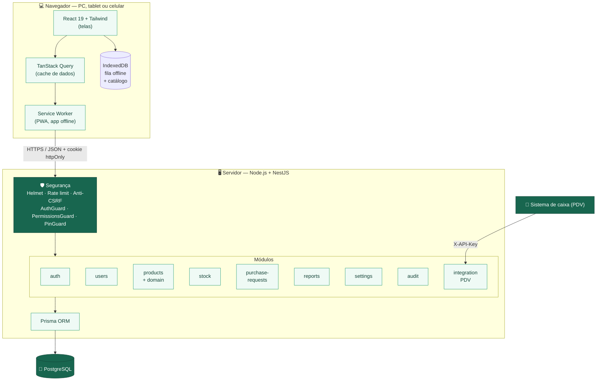

### Camadas de cada módulo

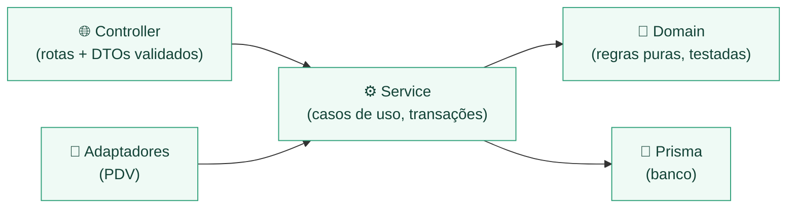

| Decisão | Motivo |
|---|---|
| **Livro de movimentações imutável** | Cada entrada e saída é um registro com o saldo resultante. O histórico dos relatórios sai pronto e permite auditar |
| **Atualização de saldo com trava de linha** | Duas vendas simultâneas nunca deixam o saldo errado |
| **ID gerado no aparelho (idempotência)** | A sincronização offline e o reenvio do PDV não duplicam registros |
| **Domínio puro** (`replenishment.ts`) | Mudar uma fórmula é mudar uma função testada, sem tocar em banco ou tela |
| **Regras em Configurações** | Lixeira, cobertura do pedido, estoque negativo e PIN são ajustáveis sem reprogramar |
| **Integração como adaptador** | Trocar de sistema de caixa afeta só o módulo `integration` |
| **PostgreSQL embutido** | Roda num PC Windows sem instalar banco, e migra para a nuvem só trocando a `DATABASE_URL` |

---

## 🗄️ Modelo de dados

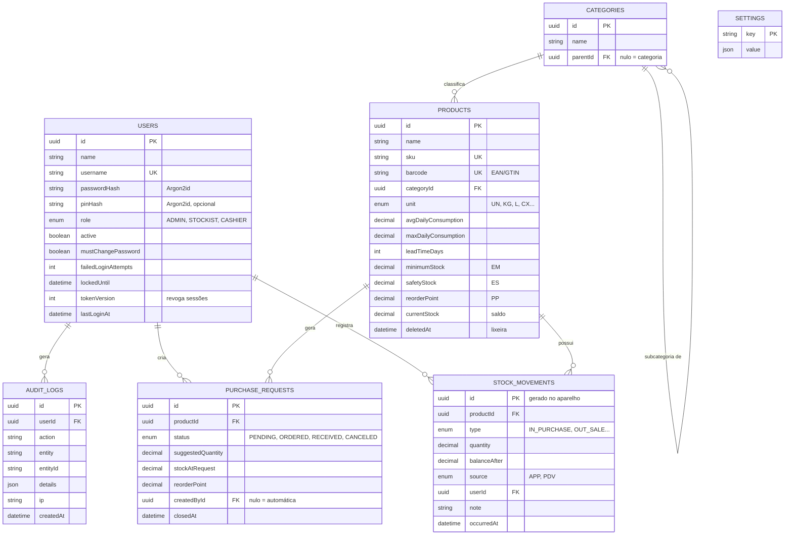

### Dicionário resumido

| Tabela | Finalidade | Observações |
|---|---|---|
| `users` | Funcionários com acesso | Nunca são apagados, só desativados (o histórico é preservado) |
| `categories` | Categoria e subcategoria (2 níveis) | Não remove se tiver produtos ou subcategorias |
| `products` | Catálogo e saldo atual | EM, ES e PP gravados para filtros rápidos |
| `stock_movements` | Livro de entradas e saídas | Imutável, com índice por produto e data |
| `purchase_requests` | Solicitações de pedido | Uma em aberto por produto |
| `settings` | Parâmetros do sistema | JSON flexível, sem migration para novas regras |
| `audit_logs` | Rastro de ações | Logins, falhas, cadastros, exclusões |

---

## 🧩 Diagrama de classes

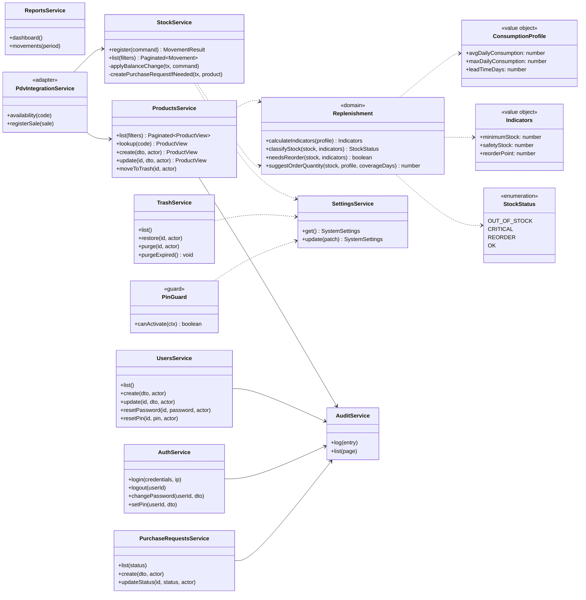

---

## 🔄 Fluxos principais

### Registrar uma venda (com alerta de reposição)

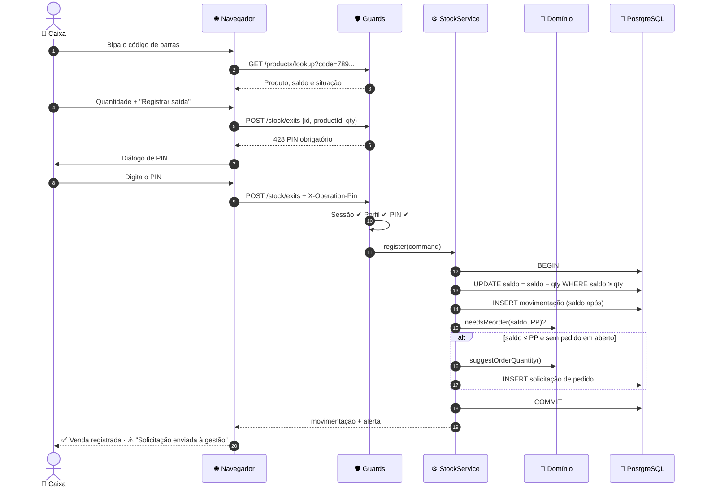

### Venda sem internet (sincronização offline)

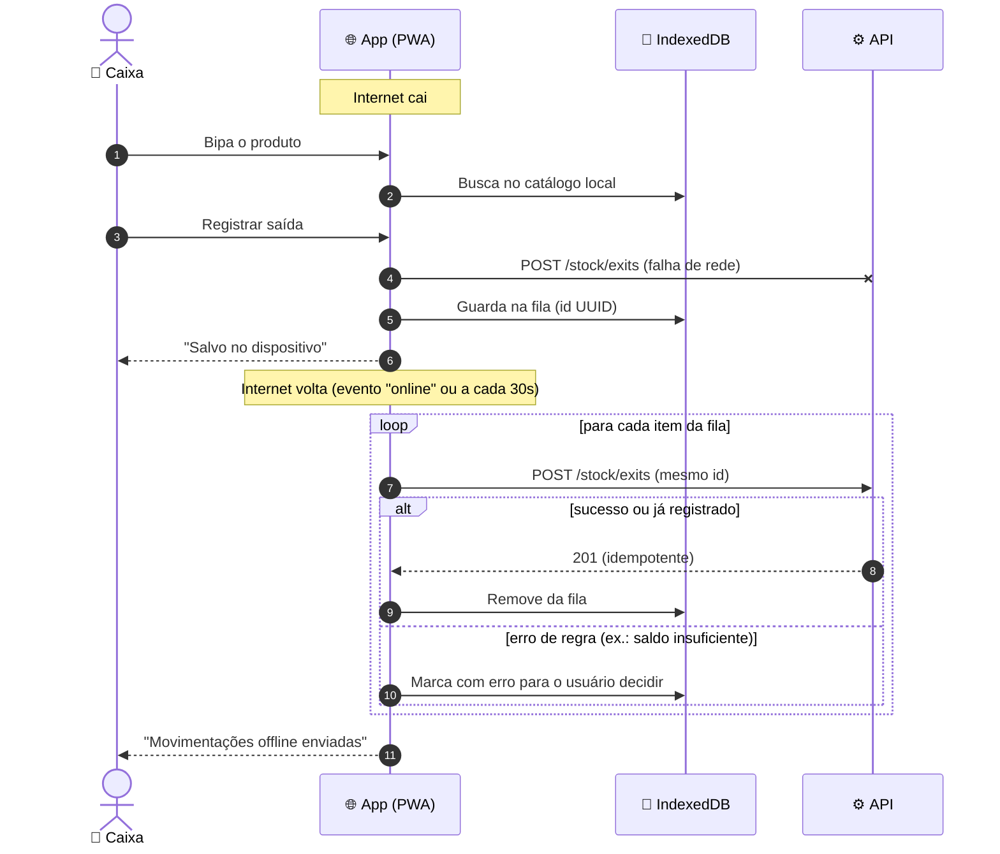

### Login e sessão

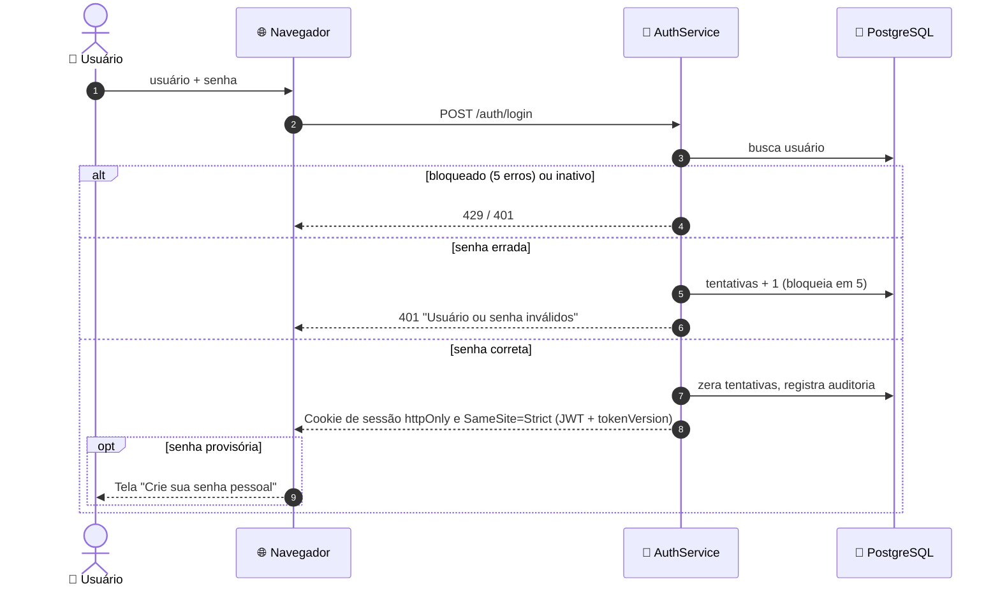

---

## 🚦 Diagramas de estado

### Solicitação de pedido

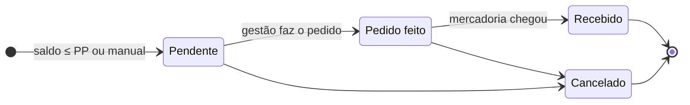

### Ciclo de vida do produto e situação do estoque

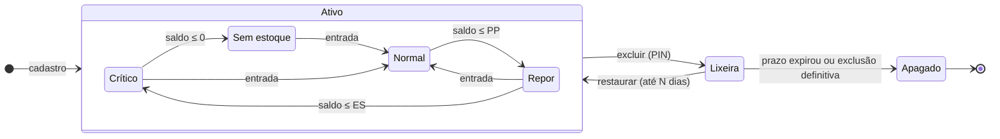

---

## 📐 Regras de negócio

### Fórmulas (conforme o documento de requisitos)

| Indicador | Sigla | Fórmula |
|---|:-:|---|
| Estoque Mínimo | **EM** | `Consumo Médio Diário × Tempo de Reposição` |
| Estoque de Segurança | **ES** | `(Consumo Máximo Diário − Consumo Médio Diário) × Tempo de Reposição` |
| Ponto de Pedido | **PP** | `(Consumo Médio Diário × Tempo de Reposição) + ES` |
| Quantidade sugerida* | — | `ES + Consumo Médio × (Tempo de Reposição + Dias de Cobertura) − Saldo` |

\* O documento não define a quantidade do pedido. Esta é uma premissa, com "dias de cobertura" configurável (padrão **7**).

**Exemplo — Pão de forma:** média 20/dia, máximo 30/dia, entrega em 3 dias.

| EM | ES | PP | Saldo 85 → sugerido |
|:-:|:-:|:-:|:-:|
| 20 × 3 = **60** | (30 − 20) × 3 = **30** | 60 + 30 = **90** | 30 + 20 × (3 + 7) − 85 = **145** |

### Situação do produto

| Situação | Condição | Cor |
|---|---|:-:|
| 🔴 Sem estoque | saldo ≤ 0 | vermelho |
| 🟠 Crítico | saldo ≤ ES | laranja |
| 🟡 Repor | saldo ≤ PP | amarelo |
| 🟢 Normal | saldo > PP | verde |

### Configurações ajustáveis

| Parâmetro | Padrão | Efeito |
|---|:-:|---|
| Dias na lixeira | 15 | Prazo para recuperar um produto excluído |
| Dias de cobertura do pedido | 7 | Usado na quantidade sugerida |
| Permitir estoque negativo | Não | Bloqueia saída maior que o saldo |
| PIN em saídas, entradas, cadastro e exclusão | Sim | Liga ou desliga a confirmação por PIN em cada operação |

---

## 👥 Perfis e permissões

| Ação | 🛡️ Administrador | 📦 Estoquista | 🧾 Caixa |
|---|:-:|:-:|:-:|
| Consultar produtos e saldo | ✅ | ✅ | ✅ |
| Registrar saída (venda, perda) | ✅ | ✅ | ✅ |
| Registrar entrada | ✅ | ✅ | — |
| Cadastrar e editar produtos e categorias | ✅ | ✅ | — |
| Movimentações, pedidos e relatórios | ✅ | ✅ | — |
| Excluir produto e gerenciar lixeira | ✅ | — | — |
| Usuários, configurações e auditoria | ✅ | — | — |

> As permissões são verificadas **no servidor** em todas as rotas. Esconder um botão na tela não é a proteção.

---

## 🔒 Segurança

| Ameaça | Proteção |
|---|---|
| Vazamento de senhas | Hash **Argon2id** (recomendação OWASP) para senhas e PINs |
| Roubo de sessão (XSS) | Sessão em cookie **httpOnly** (inacessível ao JavaScript) e **CSP** rígida |
| CSRF | Cookie **SameSite=Strict** e cabeçalho anti-CSRF obrigatório |
| Força bruta | Conta bloqueada por 15 min após 5 erros, PIN por 5 min, **rate limit** por IP |
| Sessão de funcionário desligado | `tokenVersion`: desativar, trocar senha ou sair derruba todas as sessões na hora |
| Senha padrão / fraca | Senhas aleatórias na instalação, troca obrigatória no 1º acesso, política mínima |
| Acesso indevido | Perfis (RBAC) + PIN para operações sensíveis |
| SQL injection | Consultas parametrizadas (Prisma) |
| Mass assignment | DTOs com *whitelist*: campos extras são rejeitados |
| Enumeração de usuários | Mensagem genérica e tempo de resposta igualado |
| Clickjacking, sniffing | Helmet: `frame-ancestors 'none'`, `nosniff`, `Referrer-Policy` |
| Configuração insegura | A API não sobe sem segredo forte (validação com Zod) |
| Banco exposto | PostgreSQL só escuta em `127.0.0.1` |
| Computador compartilhado | O cache offline é apagado no logout |
| Rastreabilidade | **Auditoria** de logins, falhas, cadastros, exclusões e configurações |
| Recuperação de senha | Código de 6 dígitos guardado como hash, 15 min de validade, uso único, 5 tentativas, 3 pedidos/hora, resposta genérica e sessões encerradas ao redefinir |
| Senha do e-mail de envio | Criptografada no banco com **AES-256-GCM** (chave derivada do `JWT_SECRET`); nunca sai da API; TLS obrigatório |

### ⚖️ LGPD (Lei nº 13.709/2018)

| Requisito | Como o sistema atende |
|---|---|
| Transparência (art. 6º, VI, e art. 9º) | **Termo de Uso e Política de Privacidade** em `/termos`, com controlador, encarregado, finalidades, bases legais, compartilhamento e retenção |
| Ciência do titular | Aceite obrigatório no 1º acesso, **versionado** (`TERMS_VERSION`): se o texto mudar, todos aceitam de novo. A API bloqueia o uso até o aceite |
| Minimização (art. 6º, III) | Só nome, login, e-mail (opcional, exceto admin) e auditoria. IP apagado da auditoria após **12 meses**; códigos de recuperação após 1 dia |
| Acesso e portabilidade (art. 18, II e V) | “Baixar meus dados” em Meu perfil (JSON com cadastro, auditoria e operações) |
| Correção (art. 18, III) | O próprio usuário corrige o e-mail; o administrador corrige o nome |
| Eliminação/anonimização (art. 18, IV e VI) | “Anonimizar dados” para usuários desativados: apaga nome, login, e-mail, credenciais e IPs, mantendo o histórico do estoque sem identificação |
| Encarregado (art. 41) | Nome e e-mail configuráveis em Configurações › Empresa e privacidade |
| Segurança (art. 46) | Medidas da tabela acima |

> O texto do termo fica em [`TermsContent.tsx`](apps/web/src/features/legal/TermsContent.tsx). Ele é um modelo e deve ser revisado por um profissional jurídico antes do uso definitivo.

---

## 🔌 API

Prefixo `/api`. Autenticação por cookie de sessão. A integração com o PDV usa `X-API-Key`.

| Método | Rota | Permissão | Descrição |
|---|---|---|---|
| `POST` | `/auth/login` | pública | Login (cria o cookie de sessão) |
| `POST` | `/auth/logout` | logado | Encerra e revoga sessões |
| `GET` | `/auth/me` | logado | Perfil e permissões |
| `POST` | `/auth/change-password` · `/auth/pin` | logado | Troca a senha / define o PIN (no 1º acesso: + e-mail e aceite do termo) |
| `GET` | `/auth/recovery` | pública | Se a recuperação por e-mail está ativa |
| `POST` | `/auth/forgot-password` · `/auth/reset-password` | pública | Envia o código por e-mail / redefine a senha com o código |
| `POST` | `/auth/accept-terms` | logado | Aceite da versão atual do termo |
| `PATCH` | `/auth/profile` | logado | Corrige o próprio e-mail (com a senha atual) |
| `GET` | `/auth/my-data` | logado | Exporta os próprios dados pessoais (LGPD) |
| `GET` | `/legal` | pública | Versão do termo e dados da empresa |
| `GET` | `/products` | product:read | Lista (busca, situação, categoria, paginação) |
| `GET` | `/products/lookup?code=` | product:read | Busca exata por SKU ou EAN (bipagem) |
| `POST` `PATCH` | `/products` · `/products/:id` | product:write + PIN | Cadastrar / editar |
| `DELETE` | `/products/:id` | product:delete + PIN | Enviar para a lixeira |
| `GET` `POST` `DELETE` | `/trash` · `/trash/:id/restore` · `/trash/:id` | trash:manage | Lixeira |
| `POST` | `/stock/entries` · `/stock/exits` | stock:in / stock:out + PIN | Registrar movimentação |
| `GET` | `/stock/movements` | movement:read | Histórico com filtros |
| `GET` `POST` `PATCH` | `/purchase-requests` · `/:id/status` | purchase:* | Solicitações de pedido |
| `GET` | `/reports/dashboard` · `/reports/movements` | product:read / report:read | Painel e relatório por período |
| `GET` `POST` `PATCH` | `/users` · `/users/:id/reset-password` · `/reset-pin` | user:manage | Usuários |
| `GET` `PATCH` | `/settings` | settings:manage | Configurações |
| `GET` `PUT` · `POST` | `/settings/mail` · `/settings/mail/test` | settings:manage | E-mail de envio (senha criptografada) / teste |
| `PUT` | `/settings/company` | settings:manage | Dados da empresa e do encarregado |
| `POST` | `/users/:id/anonymize` | user:manage | Anonimiza um usuário desativado (LGPD) |
| `GET` | `/audit` | audit:read | Auditoria |
| `GET` | `/integration/pdv/products/:code/availability` | X-API-Key | PDV consulta estoque |
| `POST` | `/integration/pdv/sales` | X-API-Key | PDV envia venda (idempotente por `externalId`) |

<details>
<summary><b>Exemplo de integração com o PDV</b></summary>

```http
POST /api/integration/pdv/sales
X-API-Key: <PDV_API_KEY do .env>
Content-Type: application/json

{
  "externalId": "NFCE-000123",
  "items": [
    { "code": "7896002301428", "quantity": 2 },
    { "code": "PAO-FRANCES", "quantity": 0.75 }
  ]
}
```

Reenviar o mesmo `externalId` não duplica a baixa.

</details>

---

## 🚀 Como rodar

### Opção 1 · Aplicativo para Windows (recomendado para a loja)

1. Baixe o instalador: **[VL-Estoque-Setup-1.3.0.exe](https://github.com/tassiocarvalho/vl-estoque/releases/latest/download/VL-Estoque-Setup-1.3.0.exe)**
2. Execute e siga os passos. Ele cria um atalho **VL Estoque** na área de trabalho.
3. Na primeira abertura, o app **entra sozinho como `admin`** e pede para criar a **senha pessoal e o PIN**. Ninguém precisa ver a senha provisória.
4. O **Manual de uso (PDF)** fica no menu lateral e também aparece num aviso de boas-vindas no painel. Para atualizá-lo, edite [`docs/manual/manual.html`](docs/manual/manual.html) e rode `npm run manual`.

O app abre em **janela própria** (sem barra de endereço) e já traz tudo embutido: banco PostgreSQL, API e telas. Não é preciso instalar Node.js nem nada além dele.

| Item | Onde fica |
|---|---|
| Dados do estoque | `%LOCALAPPDATA%\VLEstoque\pgdata` (preservados ao desinstalar) |
| Segredos gerados na instalação | `%LOCALAPPDATA%\VLEstoque\config.json` (a senha provisória é apagada após o primeiro acesso) |
| Logs | `%LOCALAPPDATA%\VLEstoque\logs` |
| Backups automáticos | `Meu Drive\VL Estoque - Backups` no Google Drive (ou `%LOCALAPPDATA%\VLEstoque\backups` sem o Drive) |
| Acesso pelo celular (mesma rede) | `http://IP-DO-COMPUTADOR:3030` |

#### ☁️ Backup no Google Drive

Atende ao requisito de **salvamento em nuvem** sem servidor nem mensalidade:

1. Instale o [Google Drive para computador](https://www.google.com/drive/download/) e entre com a conta Google da loja.
2. O app encontra a pasta **Meu Drive** sozinho e passa a salvar uma cópia dos dados **ao abrir, a cada 4 horas e ao fechar**. É um arquivo por dia, e ficam guardados os últimos 30 dias.
3. O Drive sincroniza essas cópias com a nuvem.

**Se o computador der defeito:** instale o Drive e o V&L Estoque no computador novo. Na primeira abertura, o app encontra o backup mais recente e pergunta se deseja **restaurar os dados**.

| Situação | O que acontece |
|---|---|
| Drive ainda não instalado | O app avisa e oferece escolher outra pasta sincronizada; enquanto isso, guarda o backup só no computador |
| Drive fechado ou sem internet | O backup é salvo no computador e o Drive envia quando voltar |
| Backup de uma versão anterior | Restaura normalmente: os dados entram no formato da versão atual |

> ⚠️ Como o instalador não tem assinatura digital, o Windows pode exibir o aviso “O Windows protegeu o computador”. Clique em **Mais informações → Executar assim mesmo**.

Para gerar um novo instalador: `npm run dist` (saída em `apps/desktop/release/`).

### Opção 2 · Pelo código-fonte

| Item | Versão |
|---|---|
| Node.js | 22 ou superior (LTS) |
| Banco de dados | Nenhuma instalação: o PostgreSQL vem embutido via npm |
| Sistema | Windows, macOS ou Linux |

### Passo a passo

```bash
# 1. Instala, gera senhas aleatórias, cria o banco e o usuário admin
npm run setup

# 2. (opcional) 22 produtos de exemplo com 30 dias de movimentação
npm run db:demo

# 3a. Desenvolvimento: http://localhost:5173
npm run dev

# 3b. Produção (uso na loja): http://localhost:3000
npm run build && npm start
```

No Windows, para usar no dia a dia, basta dar **dois cliques em `iniciar-sistema.bat`**.

O usuário inicial é `admin`. A senha aparece no fim do `setup` e fica em `apps/api/.env` (`ADMIN_INITIAL_PASSWORD`). O sistema obriga a troca no primeiro acesso.

### Comandos

| Comando | Descrição |
|---|---|
| `npm run setup` | Instalação completa (primeira vez) |
| `npm run dev` | Banco, API e front com recarga automática |
| `npm run build` · `npm start` | Build e execução em produção |
| `npm test` | Testes das regras de negócio (Vitest) |
| `npm run desktop` | Abre o app desktop (Electron) a partir do código |
| `npm run dist` | Gera o instalador do Windows (`.exe`) |
| `npm run typecheck` | Verificação de tipos da API e do front |
| `npm run db:demo -w @vl/api` | Dados de demonstração |
| `npm run db:stop -w @vl/api` | Desliga o banco embutido |
| `npm run db:studio -w @vl/api` | Abre o Prisma Studio |

> 💾 Os dados ficam em `%LOCALAPPDATA%\vl-estoque\pgdata`, **fora do OneDrive** de propósito, porque a sincronização de arquivos corrompe bancos de dados. Para publicar na nuvem, troque a `DATABASE_URL`, use **HTTPS** e defina `COOKIE_SECURE=true`.

---

## 🗂️ Estrutura de pastas

```
sistema-estoque/
├── apps/
│   ├── api/                         # Back-end (NestJS)
│   │   ├── prisma/                  # schema, migrations, seed, demo
│   │   ├── scripts/database.mjs     # PostgreSQL embutido (pg_ctl)
│   │   └── src/
│   │       ├── common/              # auth, permissões, segurança, erros
│   │       ├── config/env.ts        # variáveis validadas com Zod
│   │       └── modules/
│   │           ├── products/domain/ # 🧠 EM · ES · PP (+ testes)
│   │           ├── products/        # catálogo + lixeira
│   │           ├── stock/           # entradas e saídas
│   │           ├── purchase-requests/
│   │           ├── reports/
│   │           ├── auth/ users/ settings/ audit/ categories/
│   │           └── integration/     # 🔌 adaptador do PDV
│   ├── web/                         # Front-end (React PWA)
│   │   └── src/
│   │       ├── components/          # layout + UI reutilizável
│   │       ├── features/            # uma pasta por funcionalidade
│   │       └── lib/                 # cliente HTTP, tipos, formatação
│   └── desktop/                     # 🖥️ App Windows (Electron + instalador NSIS)
│       ├── src/main.mjs             # liga banco → migrations → API → janela
│       └── scripts/package.mjs      # gera o VL-Estoque-Setup.exe
├── docs/screenshots/
├── scripts/setup.mjs
└── iniciar-sistema.bat
```

### Stack

| Camada | Tecnologias |
|---|---|
| **Front-end** | React 19 · TypeScript · Vite 7 · Tailwind CSS 4 · TanStack Query · React Hook Form + Zod · React Router 7 · Lucide |
| **PWA / Offline** | vite-plugin-pwa (Workbox) · IndexedDB (idb-keyval) |
| **Back-end** | Node.js 24 · NestJS 11 · class-validator · @nestjs/schedule |
| **Banco** | PostgreSQL 18 · Prisma 6 |
| **Segurança** | Argon2id · JWT (cookie httpOnly) · Helmet · @nestjs/throttler |
| **Testes** | Vitest (domínio) · testes ponta a ponta da API e da interface |

---

## 📝 Pendências com o cliente

- [ ] Qual é o **sistema de caixa (PDV)** atual e como ele exporta as vendas (API, arquivo, banco)?
- [ ] Validar a **regra da quantidade sugerida** no pedido.
- [ ] Manter o **PIN em toda venda**? (padrão do documento, mas pode atrasar o caixa)
- [ ] **Ficha técnica** da padaria (baixa de insumos ao produzir) entra no escopo?
- [ ] Hospedagem em nuvem e domínio com HTTPS.

---

<div align="center">
<sub>Desenvolvido para a V&L Mercadinho e Panificadora · 2026</sub>
</div>
